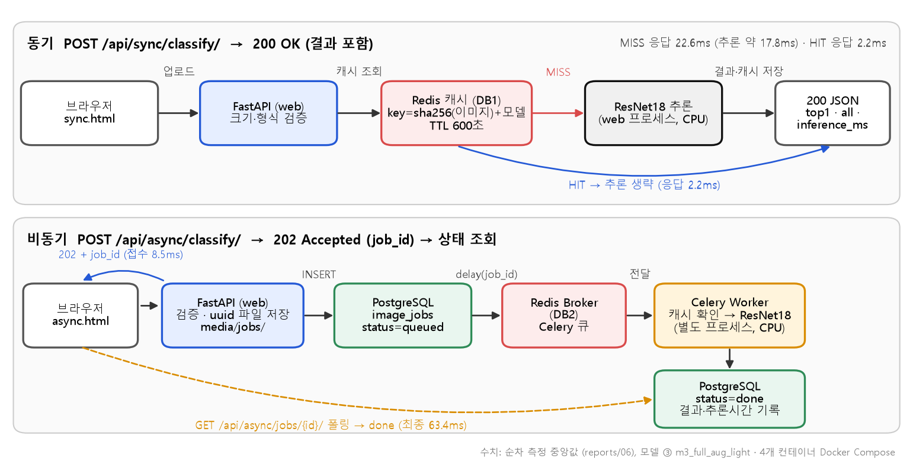
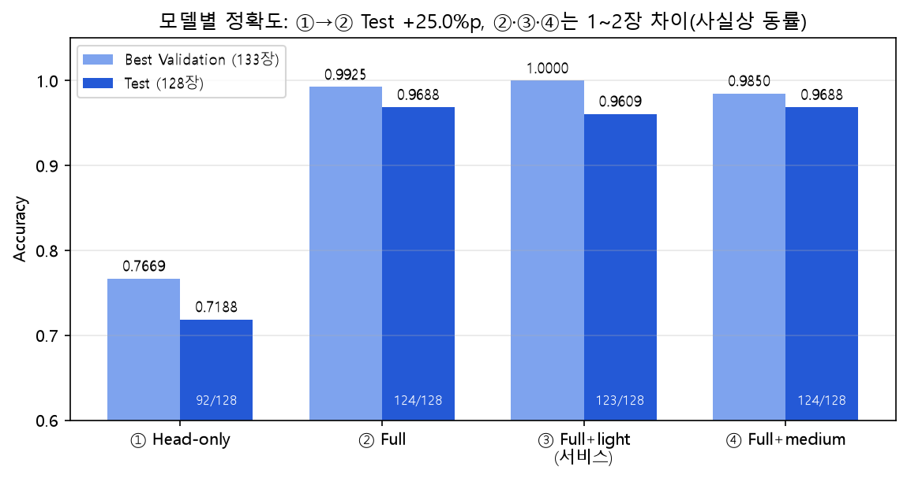
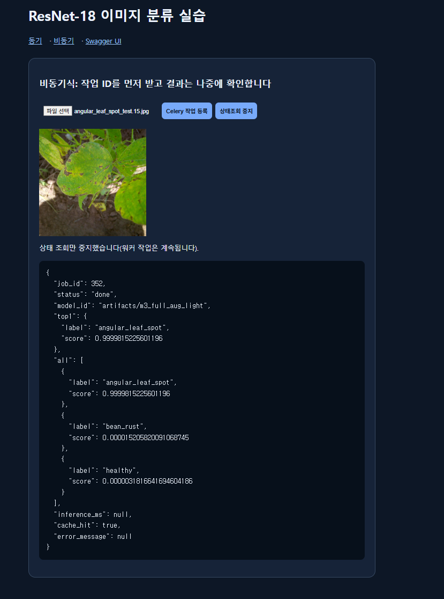
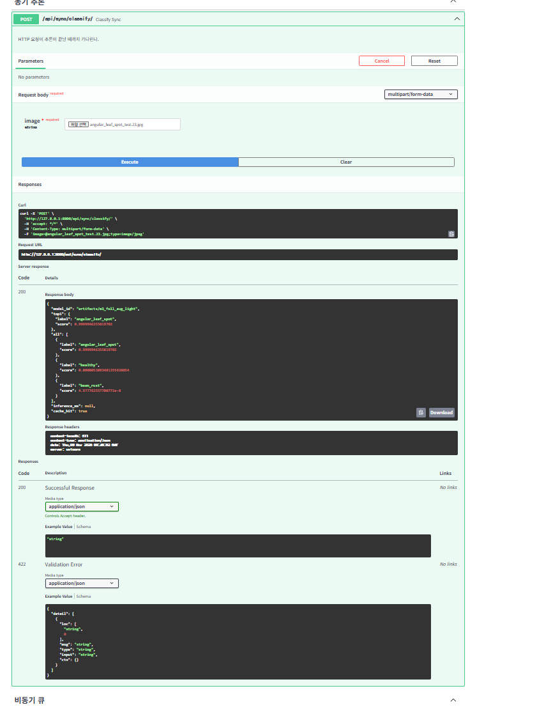

# 콩잎 분류 AI 서비스 (ResNet18 · FastAPI · Celery · Redis · PostgreSQL)

> ResNet-18을 Fine-tuning해 콩잎 병해 3종을 분류하고, 같은 모델을 **동기 API**와 **비동기(Celery) API**로 서비스한 뒤 두 방식의 성능을 같은 조건에서 직접 측정·비교한 프로젝트


## 한눈에 보기

| 항목 | 결과 |
|---|---|
| 분류 대상 | 콩잎 사진 → `angular_leaf_spot` / `bean_rust` / `healthy` |
| Test 정확도 | Head-only **71.9%** → 전체 Fine-tuning **96.9%** (+25.0%p, 128장) |
| 서비스 구성 | Docker Compose 4개 컨테이너 (FastAPI · Celery Worker · Redis · PostgreSQL) |
| 응답시간 (중앙값) | 동기 22.6ms · 캐시 HIT 2.2ms · 비동기 접수 8.5ms / 최종 63.4ms |
| 검증 | 실환경 기능 시험 **23건 PASS** (worker 중단·복구 포함) + pytest 모의 테스트 |

## 시스템 구조



- **동기:** 업로드 → 형식 검증 → Redis 캐시 조회(key = 이미지 sha256 + 모델) → MISS면 ResNet18 추론 → 결과 저장 후 200 응답
- **비동기:** 업로드 → PostgreSQL에 작업 등록(`queued`) → Redis 브로커 → Celery Worker 추론 → `done` 기록, 클라이언트는 `job_id`로 상태 조회

## 모델 실험



BASE(`microsoft/resnet-18`)에서 한 번에 한 가지씩 바꿔 4개 모델을 비교했다. 분류 헤드만 학습한 ①에서 전체 가중치를 학습한 ②로 바꾸자 정확도가 크게 올랐고, 데이터 증강(③·④)은 1~2장 차이로 사실상 동률이었다. 서비스에는 Validation 최고 점수인 ③을 적용했다.

## 화면

| 비동기 분류 화면 | Swagger API 문서 |
|---|---|
|  |  |

## 내가 한 일

- **모델 학습·평가:** 제공 학습 코드는 그대로 두고 증강 학습(`finetune_aug.py`)과 평가 스크립트를 추가해 4개 모델을 같은 Test 세트로 비교
- **서비스 구현:** 동기·비동기 API, sha256 기반 Redis 캐시(TTL 600초), PostgreSQL 작업 이력, 업로드 검증(5MB, 실제 JPG/PNG/WEBP)
- **비교 콘솔(`demo.py`):** 모델 선택 → 사진 선택 → 캐시·동시성 조건 설정 → 동기/비동기 결과를 나란히 보여 주는 단일 파일 GUI
- **자동화:** 학습 → 평가 → 비교 → 더 좋을 때만 서비스 적용까지 한 번에 돌리는 CLI(`pipeline.py`, `run.sh`)
- **측정·문서화:** 응답시간·동시 요청 측정 스크립트, 보고서 8종(`reports/`)

## 배운 점

- **비동기가 항상 빠르지는 않다.** 이 모델은 추론이 약 17ms로 짧아, 비동기는 접수만 빠르고 결과를 받기까지는 동기보다 오래 걸렸다(동시 20건: 동기 284.9ms vs 비동기 743.9ms). 비동기는 추론이 무겁거나 요청이 몰릴 때 의미가 있다.
- **비교 실험은 한 번에 하나만 바꿔야 한다.** ①→②는 전체 학습 외에 에폭·배치·학습률도 함께 달라져 "전체 학습"만의 효과를 분리할 수 없었다. ②→③④는 증강만 바꿔 공정하게 비교했다.
- **작은 Test 세트에서 1~2장 차이는 의미 있는 차이가 아니다.** 그래서 ②③④를 동률로 보고, 모델 선택 기준(Validation)을 미리 정해 두었다.

---

## 1. 폴더 구조

```text
fastapi_resnet18/
├── demo.py            ← 동기 vs 비동기 비교 콘솔 (단일 파일 GUI)
├── run.sh             ← 실행 도우미 (./run.sh = 콘솔, ./run.sh <명령> = pipeline.py)
├── pipeline.py        ← 학습·평가·비교·서비스 적용 통합 CLI
├── main.py, ai/       ← FastAPI 서비스 (동기·비동기 API, Redis 캐시, Celery 작업)
├── training/          ← 학습(finetune.py 제공본, finetune_aug.py 증강판), 평가(evaluate.py)
├── artifacts/         ← 학습된 모델 4개 (m1~m4)
├── dataset/           ← train / val / test (저장소에 포함하지 않음)
├── compose.yaml, Dockerfile, .env  ← Docker 4개 서비스 설정
├── reports/           ← 산출물 01~08, data/(측정 원본), evidence/(증빙), figures/(그림)
├── scripts/           ← 시험·측정·증빙 수집·그림 생성 스크립트
└── tests/             ← 모의(mock) 테스트
```

## 2. 모델 4개

한 단계마다 BASE(`microsoft/resnet-18`)에서 **무엇이 더해졌는지**가 이름에 드러난다.

| 폴더 | 이름 | BASE에서 더해진 것 | Best Val | Test (128장) |
|---|---|---|---:|---:|
| `m1_head_only` | ① Head-only | 출력층 1,000→3클래스 교체 + **분류 헤드만** 학습 (3ep, 배치 8, lr 2e-4) | 0.7669 | 0.7188 |
| `m2_full` | ② Full | ①에 더해 **전체 가중치** 학습 (10ep, 배치 16, lr 1e-4) | 0.9925 | 0.9688 |
| **`m3_full_aug_light`** | ③ Full + 증강 light | ②와 같고 **증강 light**만 추가 (뒤집기·회전 15°·약한 밝기) | **1.0000** | 0.9609 |
| `m4_full_aug_medium` | ④ Full + 증강 medium | ②와 같고 **증강 medium**만 추가 (확대·뒤집기·회전 30°·밝기/채도) | 0.9850 | 0.9688 |

- **서비스 모델은 ③**이다(Validation 최고 점수로 선택). 현재 값은 `.env`의 `MODEL_PATH`이며, 비교 콘솔이나 `./run.sh apply <폴더>`로 바꿀 수 있다.
- ②③④는 Val 차이가 최대 2장, Test 차이가 한 장이라 **사실상 동률**이다. ①→②에서 정확도가 크게 올랐다(Test +25.0%p).
- ①→②는 전체 학습 외에 에폭·배치·학습률도 달라서 "전체 학습"의 효과만 따로 볼 수 없다. ②→③④는 증강만 다르다.
- 폴더마다 `run_meta.json`에 카드 이름·설명·부모 모델이 들어 있어 콘솔이 읽는다.
- **정리 내역:** 아래 3개는 삭제했다. `beans_resnet18_full`(학습 옵션 미기록), `exp_C_full_5e5`(lr 5e-5 변형, 기록은 `reports/data/deleted_models/`), `exp_medium_full_s42_152903`(④와 같은 설정의 중복). 옛 이름 대응: `beans_resnet18`→`m1_head_only`, `exp_B_full_1e4`→`m2_full`, `exp_aug_light_s42`→`m3_full_aug_light`, `exp_aug_medium_s42`→`m4_full_aug_medium`.

## 3. 처음 설치

```bash
cd ~/fastapi_resnet18
python3.11 -m venv .venv        # 3.11이 없으면: uv venv --python 3.11 .venv
source .venv/bin/activate
python -m pip install -r requirements.txt
```

- Windows + WSL2 Ubuntu, Docker Desktop(Docker Compose)이 필요하다.
- 데이터: 제공 원본 `validation/`의 사진을 `dataset/val/`에 배치하고, `dataset/train/`, `dataset/val/`, `dataset/test/` 모두 같은 3클래스 폴더를 가져야 한다. `dataset/`은 용량과 사용 권한 때문에 저장소에 넣지 않았다.

## 4. 서비스 실행 (Docker 4개)

Docker Desktop을 켠 뒤:

```bash
cd ~/fastapi_resnet18
docker compose up -d --build    # redis, postgres, web(FastAPI), worker(Celery) 한 번에
docker compose ps               # 모두 healthy / Running 확인
```

- 동기 화면 http://127.0.0.1:8000/vision/sync/ · 비동기 화면 http://127.0.0.1:8000/vision/async/ · API 문서 http://127.0.0.1:8000/docs
- 모델을 바꾸거나 `.env`를 고친 뒤에는 `docker compose up -d --force-recreate web worker`.
- 정지: `docker compose stop` (데이터 보존). **`docker compose down -v`는 DB·Redis 데이터를 지우므로 쓰지 않는다.**

## 5. 동기 vs 비동기 비교 콘솔 (`demo.py`)

```bash
cd ~/fastapi_resnet18
./run.sh                 # → http://127.0.0.1:8200   (종료: Ctrl+C)
./run.sh --up            # Docker 서비스도 함께 시작
```

| 단계 | 하는 일 |
|---|---|
| 1 모델 선택 | 카드 `BASE → ① → ② → ③ → ④`에서 고른다. 카드에 더해진 것이 한 줄로 쓰여 있고, 고르면 BASE 대비 변경점이 나온다 |
| 2 사진 고르기 | **내 사진 올리기**(끌어다 놓기·클릭·Ctrl+V, 여러 장, 사진별 정답 지정) 또는 **test 사진에서 고르기**. 섞어도 된다. 안 고르면 클래스 균형 무작위 |
| 3 설정·실행 | 캐시 조건(MISS/HIT/둘 다), 실험 방식(순차/동시) |
| 4 결과 | 정확도, 응답시간, 결과를 받기까지의 시간, 총 소요, 추론시간, 캐시 HIT 수를 동기·비동기 나란히 + 자동 해석 + 사진별 표 |

- 모델을 고르면 서비스의 `MODEL_PATH`를 바꾸고 web·worker를 다시 시작한다(약 30초). 되돌리려면 그 모델을 다시 골라 비교한다. `.env`는 `.env.bak`으로 백업된다.
- 업로드 사진은 서비스 API와 같은 기준(5MB 이하, 실제 JPG/PNG/WEBP)으로 미리 검사한다. 사진은 2~60장(동시 실험은 40장)까지 가능하다.
- MISS 조건은 Redis 캐시 DB(1)만 비운다. 127.0.0.1에만 바인딩되며 인증은 없다.
- 사진이 적을 때 정확도는 우연의 영향이 크다(화면에도 표시).

## 6. 학습·평가·통합 명령

```bash
./run.sh train --augment light --eval            # 증강 Fine-tuning + test 평가
./run.sh compare                                 # 저장된 모델 비교표 (Val 기준 정렬)
./run.sh evaluate                                # 아직 평가하지 않은 모델을 test로 평가
./run.sh apply m3_full_aug_light                 # 서비스(.env + web/worker)에 모델 적용
./run.sh sweep --augment none light medium --seeds 42 43 44   # 증강 반복 비교
./run.sh all --augment light --apply-if-better   # 학습 → 평가 → 비교 → Val이 더 높을 때만 적용
./run.sh status | ./run.sh services restart
```

처음부터 같은 모델을 만드는 명령:

```bash
python -m training.finetune --data dataset --output artifacts/m1_head_only --epochs 3 --batch-size 8 --freeze-backbone
python -m training.finetune --data dataset --output artifacts/m2_full --epochs 10 --batch-size 16 --lr 1e-4
python -m training.finetune_aug --augment light  --seed 42 --output artifacts/m3_full_aug_light
python -m training.finetune_aug --augment medium --seed 42 --output artifacts/m4_full_aug_medium
python -m training.evaluate --models artifacts/m1_head_only artifacts/m2_full artifacts/m3_full_aug_light artifacts/m4_full_aug_medium --split test
```

제공 `training/finetune.py`는 수정하지 않았다. 증강 학습은 `finetune_aug.py`(`none`/`light`/`medium`, train에만 적용)가 한다.

## 7. 테스트·측정 재실행

```bash
python -m pytest -q                                   # 모의(mock) 테스트 4개
docker compose exec web pytest -q tests/test_api.py   # 컨테이너 안에서 같은 테스트
python scripts/functional_tests.py    # 실환경 통합 시험 23건 (worker·redis를 잠시 멈췄다가 복구함)
python scripts/measure_timings.py     # 동기/비동기 × 캐시 MISS/HIT 응답시간 (캐시 DB/1을 비움)
```

동시 요청 실험은 `python demo.py --port 8201`을 띄운 뒤 `python scripts/measure_burst.py`. Test 평가는 `python -m training.evaluate`(6절)로 다시 할 수 있다. 증빙 수집·그래프 생성용 보조 스크립트는 제출물에서 제외했다(결과물은 `reports/data/`, `reports/figures/`, `reports/evidence/`에 남아 있다).

## 8. 결과 요약

| 항목 | 값 |
|---|---|
| Test 정확도 | ① 0.7188 → ② 0.9688 → ③ 0.9609 → ④ 0.9688 (128장) |
| 동기·비동기 정확도 | **같음** (같은 모델, 예측 라벨 일치 100%) |
| 응답시간 중앙값 (순차, ③) | 동기 22.6ms · 동기 HIT 2.2ms · 비동기 접수 8.5ms · 비동기 최종 63.4ms |
| 동시 20건 전체 완료 (MISS) | 동기 284.9ms · 비동기 743.9ms |
| 기능 시험 | 23건 모두 PASS |

이 모델은 추론이 약 17ms로 빨라서 **비동기의 이점이 드러나지 않았다**(접수 응답은 빠르지만 결과를 받기까지는 더 걸림). 자세한 해석과 한계는 `reports/06_성능비교_보고서.md`.

## 9. 산출물 (`reports/`)

| 번호 | 문서 |
|---|---|
| 1 | `01_FineTuning_결과보고서.md` — 데이터·학습·Test 평가·모델 선택·증강 실험 |
| 2 | `02_시스템_아키텍처.md` |
| 3 | `03_API_명세서.md` |
| 4 | `04_DB_구조_작업이력.md` |
| 5 | `05_AI버튼_처리흐름.md` |
| 6 | `06_성능비교_보고서.md` |
| 7 | `07_기능테스트_오류분석.md` |
| 8 | `08_최종기술보고서.md` (+ 이 README) |

원본 측정값은 `reports/data/`, 증빙은 `reports/evidence/`(실행 화면 캡처 `*.png`와 로그·SQL 출력·API 응답), 그림은 `reports/figures/`에 있다.

## 10. 자주 막히는 곳

| 증상 | 해결 |
|---|---|
| `./run.sh: No such file or directory` | 프로젝트 폴더에서 실행: `cd ~/fastapi_resnet18` |
| `docker`를 찾을 수 없다 / 연결 실패 | Docker Desktop을 켜고 잠시 기다린다 |
| 콘솔이 `address already in use` | 이전 콘솔이 켜져 있다. 종료(`Ctrl+C`)하거나 `python demo.py --port 8201` |
| `permission denied ... docker.sock` | 터미널을 새로 연다(docker 그룹 적용). 안 되면 PowerShell에서 `wsl --shutdown` |
| 비동기 작업이 계속 `queued` | `docker compose logs worker` 확인, worker가 떠 있는지 `docker compose ps` |
| 응답 라벨이 ImageNet 클래스 | `.env`의 `MODEL_PATH`가 학습 결과 폴더를 가리키는지 확인 후 `--force-recreate web worker` |

## 11. 제출 및 보안

- `.env`, 비밀번호, API 키는 저장소에 올리지 않는다(`.gitignore`). DB 계정 `vision_user/vision_pass`는 `compose.yaml`의 **학습용 값**이므로 실제 서비스에 쓰지 않는다.
- `dataset/`과 `media/jobs/`는 용량·권한 때문에 저장소에서 제외한다. 확보·배치는 3절을 따른다. 학습된 모델 4개(`artifacts/*/model.safetensors`)는 바로 실행할 수 있도록 저장소에 포함했다.
- 서비스(8000)와 콘솔(8200)은 `127.0.0.1`에만 바인딩되며 인증이 없다(로컬 학습용).
