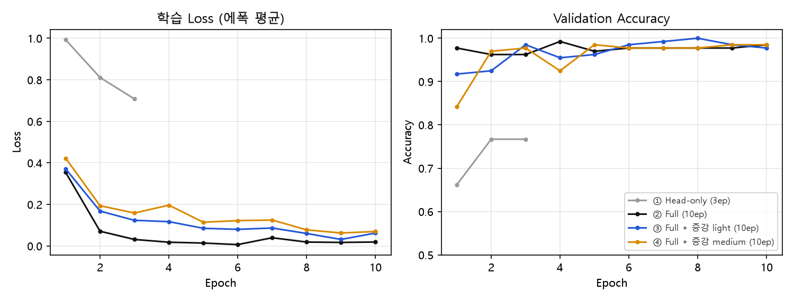
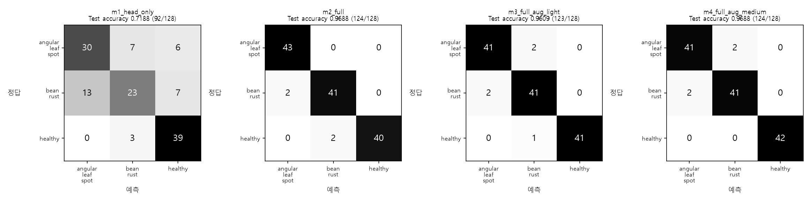
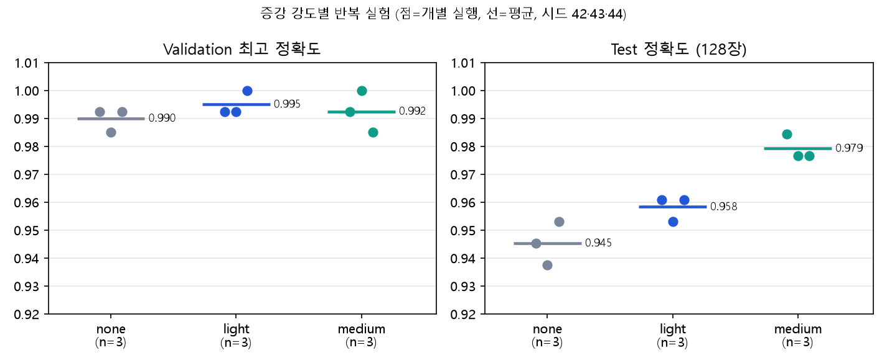
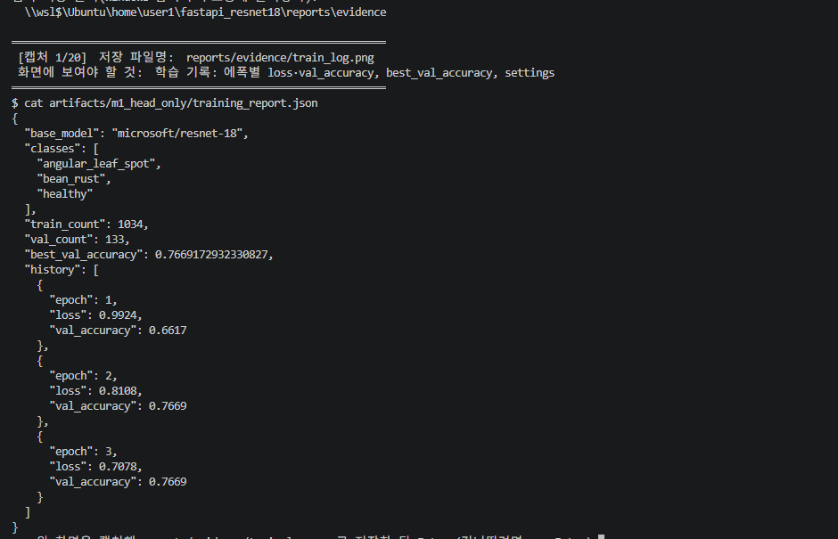
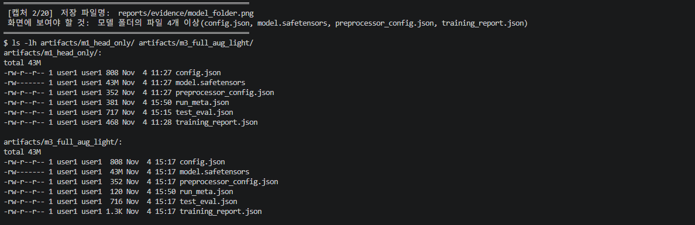

# 01. ResNet18 콩잎 3클래스 Fine-tuning 결과보고서

- 평가 대상: 콩잎 질병 이미지 3종 분류 (`angular_leaf_spot`, `bean_rust`, `healthy`)
- 기준(BASE) 모델: `microsoft/resnet-18` (ImageNet 1,000클래스 → 출력층을 3클래스로 교체)
- 학습 환경: WSL2 Ubuntu 가상환경(Python 3.11.17), NVIDIA GeForce RTX 3060 (GPU 학습)
- 데이터: 학습 `dataset/train`, 검증 `dataset/val`, 학습·모델 선택에 쓰지 않은 평가 `dataset/test`
- **서비스에 적용한 최종 모델: ③ `m3_full_aug_light`** (선택 근거는 5절)

> 모든 숫자는 `reports/data/`의 원본 기록(`training_report_*.json`, `test_eval.json`, `aug_sweep.json`)에서 옮겼다.

## 0. 한눈에 보기

| 모델 | BASE에서 더해진 것 | Best Val | Test (128장) |
|---|---|---:|---:|
| ① `m1_head_only` | 출력층 교체 + **분류 헤드만** 학습 (3ep) | 0.7669 | 0.7188 (92/128) |
| ② `m2_full` | ① + **전체 가중치** 학습 (10ep) | 0.9925 | 0.9688 (124/128) |
| **③ `m3_full_aug_light`** | ② + **데이터 증강 light** | **1.0000** | 0.9609 (123/128) |
| ④ `m4_full_aug_medium` | ② + **데이터 증강 medium** | 0.9850 | 0.9688 (124/128) |

- ①→②에서 정확도가 크게 올랐다(Test +25.0%p). ②→③④ 사이의 차이는 한두 장 수준이라 **사실상 같은 성능**이다.
- Test 128장에서는 한 장이 0.78%p이다.

---

## 1. 데이터

| 클래스 | Train | Validation | Test |
|---|---:|---:|---:|
| angular_leaf_spot | 345 | 44 | 43 |
| bean_rust | 348 | 45 | 43 |
| healthy | 341 | 44 | 42 |
| **합계** | **1,034** | **133** | **128** |

총 1,295장. 원본 기록: [data/dataset_check.json](data/dataset_check.json)

| 제공 원본 폴더 | 코드 실행용 폴더 | 처리 |
|---|---|---|
| `train/` | `dataset/train/` | 그대로 사용 |
| `validation/` | `dataset/val/` | 제공 학습 코드가 `val`을 읽으므로 폴더 이름을 바꿈(`mv`) |
| `test/` | `dataset/test/` | 학습·모델 선택에 사용하지 않음 |

- 클래스 라벨은 폴더 이름을 그대로 따른다. 이미지 내용으로 정답을 임의 판정하지 않았다.
- 원본 데이터의 별도 보존본이 있는지는 **제출자가 확인**해야 한다.

**누출·중복 점검 (실제 수행)**

| 점검 | 방법 | 결과 |
|---|---|---|
| 완전 동일 파일 | 전체 1,295장 SHA-256 비교 | 고유 해시 1,295개 → **중복 0건**, split 간 중복 **0건** |
| 이미지가 아닌 파일 | 확장자 검사 | 없음 |
| 같은 잎을 다르게 찍은 유사 사진 | **미수행** | 해시 비교로는 찾지 못함. 한계로 기록 |

---

## 2. 모델 구성과 학습 설정

| 모델 | 학습 코드 | 방식 | 에폭 | 배치 | lr | 증강 | 시드 |
|---|---|---|---:|---:|---|---|---:|
| ① m1_head_only | 제공 `finetune.py` | Head-only (Backbone 고정) | 3 | 8 | 2e-4 | 없음 | 42 |
| ② m2_full | 제공 `finetune.py` | Full (전체 학습) | 10 | 16 | 1e-4 | 없음 | 42 |
| ③ m3_full_aug_light | `finetune_aug.py` | Full | 10 | 16 | 1e-4 | light | 42 |
| ④ m4_full_aug_medium | `finetune_aug.py` | Full | 10 | 16 | 1e-4 | medium | 42 |

```bash
# ① Head-only
python -m training.finetune --data dataset --output artifacts/m1_head_only --epochs 3 --batch-size 8 --freeze-backbone
# ② Full
python -m training.finetune --data dataset --output artifacts/m2_full --epochs 10 --batch-size 16 --lr 1e-4
# ③ ④ Full + 증강
python -m training.finetune_aug --augment light  --seed 42 --output artifacts/m3_full_aug_light
python -m training.finetune_aug --augment medium --seed 42 --output artifacts/m4_full_aug_medium
```

| 증강 강도 | 적용 내용 (train에만 적용, val·test는 원본 그대로) |
|---|---|
| light | 좌우·상하 뒤집기, 회전 ±15°, 밝기·대비 ±15% |
| medium | 무작위 확대(70~100%), 뒤집기, 회전 ±30°, 밝기·대비 ±25%, 채도 ±10% |

- 제공 `training/finetune.py`는 **수정하지 않았다.** 증강 학습은 별도 파일 `training/finetune_aug.py`로 했다. ③④는 ②와 증강만 다르고, 증강 외 학습 절차는 같다(난수 사용 방식만 다름).
- ①→②는 학습 방식 외에 에폭·배치·학습률도 달라서 **"전체 학습"의 효과만 따로 떼어 볼 수 없다.**
- ①은 Head-only이며 전체 모델 학습이 아니다.

---

## 3. 학습 결과

| 에폭 | ① Loss / Val | ② Loss / Val | ③ Loss / Val | ④ Loss / Val |
|---:|---|---|---|---|
| 1 | 0.9924 / 0.6617 | 0.3541 / 0.9774 | 0.3711 / 0.9173 | 0.4225 / 0.8421 |
| 2 | 0.8108 / 0.7669 | 0.0708 / 0.9624 | 0.1676 / 0.9248 | 0.1935 / 0.9699 |
| 3 | 0.7078 / 0.7669 | 0.0311 / 0.9624 | 0.1233 / 0.9850 | 0.1585 / 0.9774 |
| 4 | – | 0.0179 / **0.9925** | 0.1169 / 0.9549 | 0.1962 / 0.9248 |
| 5 | – | 0.0138 / 0.9699 | 0.0849 / 0.9624 | 0.1140 / **0.9850** |
| 6 | – | 0.0064 / 0.9774 | 0.0798 / 0.9850 | 0.1219 / 0.9774 |
| 7 | – | 0.0394 / 0.9774 | 0.0863 / 0.9925 | 0.1248 / 0.9774 |
| 8 | – | 0.0187 / 0.9774 | 0.0600 / **1.0000** | 0.0773 / 0.9774 |
| 9 | – | 0.0169 / 0.9774 | 0.0313 / 0.9850 | 0.0623 / 0.9850 |
| 10 | – | 0.0189 / 0.9850 | 0.0620 / 0.9774 | 0.0694 / 0.9850 |
| **저장된 시점** | 2에폭 | 4에폭 | 8에폭 | 5에폭 |



- 학습 코드는 **Validation Accuracy가 최고인 에폭의 가중치만 저장**한다. 마지막 에폭이 아니라 표의 굵은 에폭이 저장된다.
- 증강 모델(③④)은 학습 Loss가 더 높게 유지된다. 매 에폭 조금씩 다른 사진을 보기 때문이며, 외우기가 어려워졌다는 뜻이다.
- 검증 데이터는 133장이라 한 장이 약 0.75%p이다. ②(0.9925)·③(1.0000)·④(0.9850)의 차이는 **최대 2장**이다.

---

## 4. Test 평가

제공 `finetune.py`는 Test 지표를 계산하지 않는다. 그래서 **`training/evaluate.py`를 추가로 작성**해 학습에 쓰지 않은 `dataset/test` 128장을 평가했다(제공 코드가 아님). 원본: [data/test_eval.json](data/test_eval.json)

| 모델 | 정답 / 전체 | Test Accuracy |
|---|---:|---:|
| ① m1_head_only | 92 / 128 | 0.7188 |
| ② m2_full | 124 / 128 | 0.9688 |
| ③ m3_full_aug_light | 123 / 128 | 0.9609 |
| ④ m4_full_aug_medium | 124 / 128 | 0.9688 |



**클래스별 Precision / Recall / F1 (Test)**

| 클래스 | ① P/R/F1 | ② P/R/F1 | ③ P/R/F1 | ④ P/R/F1 |
|---|---|---|---|---|
| angular_leaf_spot | 0.698 / 0.698 / 0.698 | 0.956 / 1.000 / 0.977 | 0.954 / 0.954 / 0.954 | 0.954 / 0.954 / 0.954 |
| bean_rust | 0.697 / **0.535** / 0.605 | 0.954 / 0.954 / 0.954 | 0.932 / 0.954 / 0.943 | 0.954 / 0.954 / 0.954 |
| healthy | 0.750 / 0.929 / 0.830 | 1.000 / 0.952 / 0.976 | 1.000 / 0.976 / 0.988 | 1.000 / 1.000 / 1.000 |

- ①은 `bean_rust`를 절반 가까이 놓쳤다(재현율 0.535). ②③④는 세 클래스를 고르게 맞힌다.
- 틀리는 경우는 대부분 `angular_leaf_spot`과 `bean_rust`를 서로 헷갈리는 것이다.

---

## 5. 모델 선택

**선택 규칙:** 모델은 **Validation 최고 점수**로 고른다. Test는 선택에 쓰지 않고 확정 후 보고용으로만 측정한다.

| 순위(Val) | 모델 | Best Val | 133장 중 틀린 수 |
|---:|---|---:|---:|
| 1 | ③ m3_full_aug_light | 1.0000 | 0 |
| 2 | ② m2_full | 0.9925 | 1 |
| 3 | ④ m4_full_aug_medium | 0.9850 | 2 |
| 4 | ① m1_head_only | 0.7669 | 31 |

- 규칙에 따라 **③ `m3_full_aug_light`를 서비스 모델로 적용**했다(`.env`의 `MODEL_PATH=artifacts/m3_full_aug_light`).
- 단, ②③④의 Val 차이는 최대 2장이고 Test 차이는 한 장이다. **세 모델은 사실상 동률**이며, ③이 우월하다는 증거는 아니다. Val 1.0000도 10개 에폭 중 가장 좋은 값을 고른 것이라 약간 낙관적이다.
- 서비스 모델은 비교 콘솔(`demo.py`)이나 `./run.sh apply <모델>`로 바꿀 수 있다.

---

## 6. 데이터 증강 반복 실험 (선택 실험)

증강 효과가 우연인지 가리기 위해 **증강 3종 × 시드 3개 = 9회**를 반복했다. 공통 설정은 Full, 10 에폭, 배치 16, lr 1e-4이고 **증강만** 바꿨다(1회 약 30초). 원본: [data/aug_sweep.json](data/aug_sweep.json), [data/aug_sweep_summary.md](data/aug_sweep_summary.md), 실행별 기록 `data/aug_sweep_runs/`

| 증강 | 반복 | Val 평균±표준편차 | Val 범위 | **Test 평균±표준편차** | Test 범위 |
|---|---:|---|---|---|---|
| none | 3 | 0.9900 ± 0.0043 | 0.9850~0.9925 | **0.9453** ± 0.0078 | 0.9375~0.9531 |
| light | 3 | 0.9950 ± 0.0043 | 0.9925~1.0000 | **0.9583** ± 0.0045 | 0.9531~0.9609 |
| medium | 3 | 0.9925 ± 0.0075 | 0.9850~1.0000 | **0.9792** ± 0.0045 | 0.9766~0.9844 |



| 증강 | 실행별 Val 최고 (시드 42/43/44) | 실행별 Test 정답 수 / 128 |
|---|---|---|
| none | 0.9925 / 0.9850 / 0.9925 | 121 / 120 / 122 |
| light | 0.9925 / 0.9925 / 1.0000 | 123 / 122 / 123 |
| medium | 0.9925 / 1.0000 / 0.9850 | 126 / 125 / 125 |

**해석**
1. **Validation은 포화되어 증강을 구분하지 못한다.** 모든 실행이 0.985~1.000이다.
2. Test에서는 증강이 강할수록 평균이 올랐다(0.945 → 0.958 → 0.979). `none`의 최고(0.9531)가 `medium`의 최저(0.9766)보다 낮아 두 설정은 범위가 겹치지 않는다. `light`와 `none`은 범위가 겹친다.
3. 같은 시드로 다시 학습해도 결과가 달랐다. 반복 실험의 `medium` 시드 42는 Test 0.9844이고, 보관용으로 다시 학습한 ④는 0.9688이다. GPU 연산이 완전히 결정적이지 않아 최대 2장 흔들린다.
4. 제공 코드로 한 번 학습한 ②(0.9688)는 이 실험의 `none` 범위(0.9375~0.9531)보다 높다. **1회 학습 결과에는 운이 섞여 있어, 모델 한 개씩만 비교한 결과로 결론을 내리면 안 된다.**

**한계:** 반복은 3회, Test는 128장이다. **이 비교에서는 Validation이 포화되어 Test를 사용**했으므로 `medium`의 0.979는 방법을 고르는 데 쓰인 숫자라 최종 성능으로 보고하면 낙관적이다. 결론은 "증강이 Test 평균을 올리는 **경향**이 관찰되었다" 수준이며, 새 데이터로 확인해야 한다.

---

## 7. 생성 파일 확인

- [x] `config.json`, `model.safetensors`(약 43MB), `preprocessor_config.json`, `training_report.json`, `test_eval.json`, `run_meta.json` — 4개 모델 폴더 모두
- 증빙: [evidence/model_folders.txt](evidence/model_folders.txt)





## 8. 정리한 모델과 한계

- **삭제한 모델:** `beans_resnet18_full`(학습 옵션이 기록되지 않은 결과), `exp_C_full_5e5`(lr 5e-5 변형: Val 0.9850 / Test 0.9766), `exp_medium_full_s42_152903`(④와 같은 설정의 중복: Val 0.9850 / Test 0.9844). 전체 목적상 비교에 필요하지 않아 정리했다. `exp_C_full_5e5`의 학습 기록은 [data/deleted_models/](data/deleted_models/)에 남겼고, 같은 명령으로 다시 만들 수 있다.
- **한계**
  - Test 128장이라 한 장당 0.78%p이다. ②③④의 차이는 구분할 수 없다.
  - 같은 잎의 유사 사진이 split에 걸쳐 있는지는 점검하지 못했다.
  - 현장 조명·배경이 다른 사진, 데이터셋 밖 이미지의 성능은 측정하지 않았다.
  - ①②는 시드 42로 1회, ③④도 1회씩 학습했다. 반복 변동은 증강 실험(3시드)으로만 측정했다.
