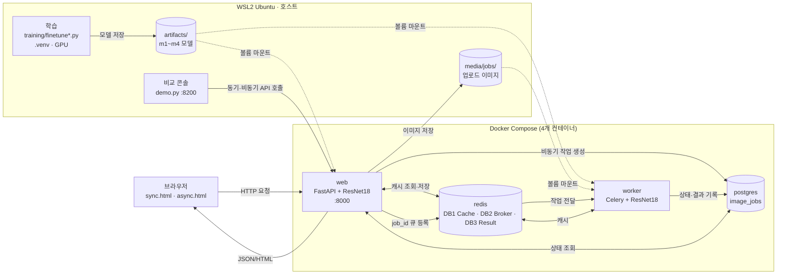
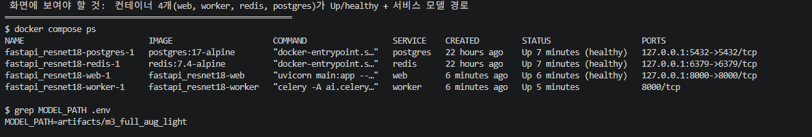

# 02. 전체 시스템 아키텍처 설계서

## 1. 구성도

## 2. 컴포넌트 역할

| 컴포넌트 | 실행 위치 | 사용 파일 / 서비스 | 역할 |
|---|---|---|---|
| 브라우저 | Windows | `templates/sync.html`, `templates/async.html` | 사진 업로드·결과 표시, 비동기 상태 폴링 |
| FastAPI (`web`) | **Docker 컨테이너** | `main.py`, `ai/router_sync.py`, `router_async.py`, `router_web.py` | 요청 접수·검증·응답, 동기 추론 |
| ResNet18 (web용) | `web` 프로세스 메모리 | `ai/hf_model.py`, `artifacts/m3_full_aug_light/` | 동기 요청 추론 (CPU) |
| Celery Worker | **Docker 컨테이너** | `ai/celery_app.py`, `ai/tasks.py` | 비동기 추론, DB 상태 갱신 |
| ResNet18 (worker용) | `worker` 프로세스 메모리 | 같은 모델 파일 | 비동기 요청 추론 (CPU) |
| Redis Cache | Docker `redis` · **DB/1** | `ai/cache_service.py` | 같은 사진·같은 모델의 결과 재사용 (TTL 600초) |
| Redis Broker | Docker `redis` · **DB/2** | `ai/celery_app.py` | Celery 작업 전달 |
| Redis Result Backend | Docker `redis` · **DB/3** | `ai/celery_app.py` | Celery 작업 상태 |
| PostgreSQL | Docker `postgres` | `ai/models.py`, `image_jobs` | 비동기 작업 상태·예측값 기록 |
| 학습 | **WSL2 호스트** `.venv` | `training/finetune.py`, `finetune_aug.py` | Fine-tuning (GPU), 결과를 `artifacts/`에 저장 |
| 비교 콘솔 | WSL2 호스트 | `demo.py` (단일 파일 GUI) | 위 서비스의 동기·비동기 API에 같은 사진을 보내 속도·정확도를 비교하는 **도구** (서비스의 일부가 아님) |

## 3. 실행환경 (실제값)

원본: [evidence/environment.txt](evidence/environment.txt)

| 항목 | 값 |
|---|---|
| 운영체제 | Windows 11 + WSL2 Ubuntu 26.04.1 LTS (커널 6.18.54.1-microsoft-standard-WSL2) |
| CPU / RAM | Intel Core i7-12700 (논리 20코어) / WSL 15GiB |
| GPU | NVIDIA GeForce RTX 3060 12GB — **학습에만 사용** |
| 호스트 Python | 3.11.17 (`.venv`), torch 2.15.0+cu132, transformers 4.57.6 |
| 컨테이너 Python | 3.11.18, **torch 2.5.1+cpu** (CPU 전용, CUDA 사용 불가) |
| FastAPI / Celery / SQLAlchemy / redis-py | 0.162.0 / 5.6.3 / 2.1.8 / 6.4.0 |
| Docker / Compose | 29.9.2 / v5.6.1 |
| 이미지 | `redis:7.4-alpine`, `postgres:17-alpine`, 앱 이미지(`python:3.11-slim` 기반) |
| 워커 실행 | `celery -A ai.celery_app:celery_app worker --pool=solo --concurrency=1` |
| 서비스 모델 | `artifacts/m3_full_aug_light` (`.env`의 `MODEL_PATH`) |

## 4. 구조 검증 결과 (실제 실행으로 확인)

- **동기:** 브라우저 → web → Redis 캐시 조회(MISS) → ResNet18 추론 → 캐시 저장 → HTTP 200 JSON. 같은 사진을 다시 보내면 Redis HIT, `inference_ms=null` ([07 문서](07_기능테스트_오류분석.md) T-09).
- **비동기:** 브라우저 → web → 사진 저장·검증 → PostgreSQL `queued` → Redis 큐 → HTTP 202 → worker가 작업 수신 → 캐시 확인 → (MISS면) 추론 → PostgreSQL `done` → 브라우저가 상태 조회.
- 동기 요청은 기본 코드에서 `image_jobs`에 저장하지 않는다. 동기 호출을 여러 번 해도 작업 번호가 늘지 않았다(T-02 동기 3회 뒤 다음 비동기 작업이 이어서 번호를 받음).
- 동기·비동기가 **같은 Redis 캐시(DB/1)를 공유**한다. 동기로 분류한 사진을 비동기로 보내면 worker가 캐시 HIT를 기록한다(작업 290: `cache_hit=true`, `inference_ms=NULL` — [evidence/db_rows.txt](evidence/db_rows.txt)).

**컨테이너 4개 실행 화면 (서비스 모델 `m3_full_aug_light`)**

## 5. 주의해서 읽을 점

1. **FastAPI와 Celery는 호스트 가상환경이 아니라 Docker 컨테이너에서 실행했다.** 제공된 02 문서의 `compose.yaml`이 `web`·`worker`·`redis`·`postgres`를 모두 컨테이너로 올리도록 되어 있다. 평가 지시서 샘플 구성도(FastAPI·Celery가 WSL 가상환경)와 다르며, 이 문서는 **실제 구성**을 따른다.
2. **ResNet18은 두 프로세스에 각각 로드된다.** web과 worker가 별개 프로세스이므로 모델이 메모리에 두 번 올라간다. 각 프로세스의 첫 추론은 모델 로딩 때문에 느리다(실측 약 2.1초, 이후 약 17ms).
3. Redis 캐시(DB/1)와 Broker(DB/2)는 **같은 Redis 서버의 다른 논리 DB**이며 역할이 다르다.
4. web과 worker는 사진을 `media/jobs/` 공유 폴더로 주고받는다(메모리를 공유하지 못하기 때문).
5. 추론은 컨테이너에서 **CPU**로 수행된다. GPU는 학습에만 사용했다.
6. PostgreSQL의 시각은 UTC로 저장된다(한국 시간과 9시간 차이).
7. 비교 콘솔로 모델을 고르면 서비스의 `MODEL_PATH`가 바뀌고 web·worker가 재시작된다. 이 보고서의 측정·시험은 `m3_full_aug_light`로 설정한 상태에서 수행했다.
