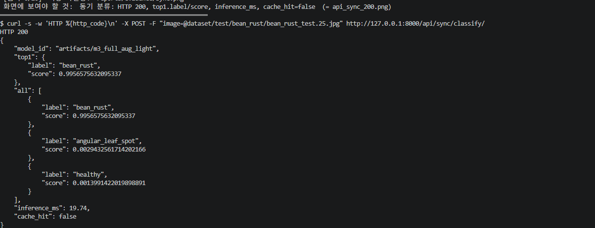
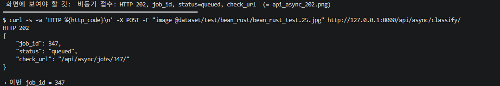
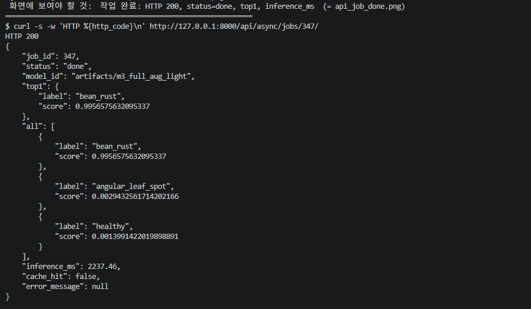

# 03. API 명세서

Base URL: `http://127.0.0.1:8000` · 응답 원문 증빙: [evidence/api_samples.txt](evidence/api_samples.txt), [evidence/api_async_job_done.json](evidence/api_async_job_done.json)

## 1. API 목록

| API ID | Method | URL | 요청 형태 | 성공 HTTP | 주요 응답 | 실패 HTTP |
|---|---|---|---|---:|---|---|
| API-01 | GET | `/health` | 없음 | 200 | `status` | 서버 미실행 시 HTTP 응답 없음 |
| API-02 | POST | `/api/sync/classify/` | `multipart/form-data` / `image` | 200 | `model_id`, `top1`, `all`, `inference_ms`, `cache_hit` | 400, 413 |
| API-03 | POST | `/api/async/classify/` | `multipart/form-data` / `image` | **202** | `job_id`, `status`, `check_url` | 400, 413, 503 |
| API-04 | GET | `/api/async/jobs/{job_id}/` | 정수형 `job_id` (경로) | 200 | `status`, `top1`, `all`, `inference_ms`, `cache_hit`, `error_message` | 404 |
| WEB-01 | GET | `/vision/sync/` | 없음 | 200 | HTML | — |
| WEB-02 | GET | `/vision/async/` | 없음 | 200 | HTML | — |
| DOC-01 | GET | `/docs` | 없음 | 200 | Swagger UI | — |

`/`는 `/vision/sync/`로 리다이렉트된다.

## 2. API-02 동기 분류

| 항목 | 내용 |
|---|---|
| 요청 필드 | `image` — JPEG, PNG, WEBP / **5MB 이하** / 1,200만 픽셀 이하 |
| 성공 | 200 OK. 추론이 끝난 뒤 결과를 응답 본문에 포함 |
| 오류 | 400 잘못된 이미지·형식·해상도, 413 크기 초과 |
| 처리 | 크기·형식 검증 → Redis 캐시 조회 → MISS면 추론 → 캐시 저장(600초) |

**성공 응답 — 캐시 MISS (실제 응답)**

```json
{"model_id":"artifacts/m3_full_aug_light",
 "top1":{"label":"bean_rust","score":0.9956575632095337},
 "all":[{"label":"bean_rust","score":0.9956575632095337},
        {"label":"angular_leaf_spot","score":0.0029432561714202166},
        {"label":"healthy","score":0.0013991422019898891}],
 "inference_ms":17.48,"cache_hit":false}
```

**같은 사진 재요청, 캐시 HIT (실제 응답)** — 같은 내용에 `"inference_ms":null,"cache_hit":true`

- `inference_ms=null`은 **모델 추론을 생략했다**는 뜻이다. 추론시간이 0ms라는 의미가 아니다.
- `all`은 점수 내림차순이며 합이 1에 가까운 softmax 확률이다.

**오류 응답 (실제 응답)**

| 상황 | HTTP | 본문 |
|---|---:|---|
| `.txt` 파일 업로드 | 400 | `{"detail":"올바른 이미지 파일이 아닙니다."}` |
| 5MB+1바이트 업로드 | 413 | `{"detail":"5MB 이하 파일만 허용합니다."}` |

## 3. API-03 비동기 접수

| 항목 | 내용 |
|---|---|
| 요청 필드 | `image` (API-02와 동일 제한) |
| 성공 | **202 Accepted** — 작업이 접수되었을 뿐 분석은 끝나지 않았다 |
| 오류 | 400 잘못된 이미지, 413 크기 초과, **503 작업 큐(Redis) 등록 실패** |
| 처리 | 검증 → `media/jobs/<uuid>.bin` 저장 → DB `queued` 행 생성 → Celery 큐 등록 |

**접수 응답 (실제 응답)**

```json
{"job_id":290,"status":"queued","check_url":"/api/async/jobs/290/"}
```

**503 응답 — Redis를 중지한 상태에서 실제 관찰 (T-12)**

```json
{"detail":"작업 큐 등록 실패: Redis 연결을 확인하세요."}
```

이때 DB에는 해당 작업이 `failed`로 기록되고 `error_message`가 남는다. **503이 돌아오기까지 20.1초가 걸렸다.**

## 4. API-04 작업 상태 조회

| 항목 | 내용 |
|---|---|
| 상태 값 | `queued` → `running` → `done` / `failed` |
| `top1`, `all` | `done`일 때만 값이 있고, 그 외에는 `null` |
| `error_message` | `failed`일 때만 값이 있다 |
| 오류 | 404 존재하지 않는 `job_id` |

**완료 응답 (실제 응답, 캐시 HIT로 처리된 작업)**

```json
{"job_id":290,"status":"done","model_id":"artifacts/m3_full_aug_light",
 "top1":{"label":"bean_rust","score":0.9956575632095337},
 "all":[{"label":"bean_rust","score":0.9956575632095337},{"label":"angular_leaf_spot","score":0.0029432561714202166},{"label":"healthy","score":0.0013991422019898891}],
 "inference_ms":null,"cache_hit":true,"error_message":null}
```

**오류 응답 (실제 응답):** `job_id=999999` → HTTP 404 `{"detail":"해당 작업이 없습니다."}`

## 5. 실행 근거표

기능 시험 원본: [data/functional_results.json](data/functional_results.json) · 로그: [evidence/functional_tests.log](evidence/functional_tests.log)

| 검증 ID | 테스트 입력 | 실제 상태코드 | 시험 번호 |
|---|---|---:|---|
| API-01-T01 | `GET /health` | 200 | T-01 |
| API-02-T01 | Test 사진 3클래스 각 1장 | 200 (3/3 정답) | T-02a~c |
| API-02-T02 | `.txt` 업로드 | 400 | T-07 |
| API-02-T03 | 5MB+1바이트 | 413 | T-10 |
| API-03-T01 | `bean_rust` JPEG | 202 | T-03 |
| API-03-T02 | Redis 중지 상태 | 503 | T-12 |
| API-04-T01 | 접수된 `job_id=264` | 200 / done | T-04 |
| API-04-T02 | `job_id=999999` | 404 | T-08 |

**실행 화면 캡처** (보고서 본문의 시험과 별도로 한 번 더 실행하며 찍은 화면이라 `job_id`·추론시간 같은 숫자는 본문과 다를 수 있다. 확인할 것은 상태코드·응답 구조·동작 결과이다.)

| 검증 | 캡처 |
|---|---|
| API-02 동기 분류 200 | [sync.png](evidence/sync.png) |
| API-03 비동기 접수 202 | [enqueue.png](evidence/enqueue.png) |
| API-04 작업 완료 done | [done.png](evidence/done.png) |
| API-04 없는 작업 404 | [not_found.png](evidence/not_found.png) |
| Swagger UI | [swagger.png](evidence/swagger.png) |







## 6. 읽을 때 유의할 점

- **202**는 "접수"이고, **상태 조회 응답의 `done`**이 "분석 완료"이다.
- 응답 필드명은 `all`이다. `all_scores`는 DB 컬럼명이며 API 응답에는 쓰지 않는다.
- 캐시 HIT 응답의 `inference_ms=null`은 추론 생략을 뜻한다.
- 인증은 없다(학습용 로컬 서비스). 포트는 `127.0.0.1`에만 바인딩된다.
- Swagger UI에서 동기 API를 실행한 화면은 `evidence/swagger.png`에 있다(같은 사진을 이미 분류한 뒤라 캐시 HIT 응답: `inference_ms=null`, `cache_hit=true`).
