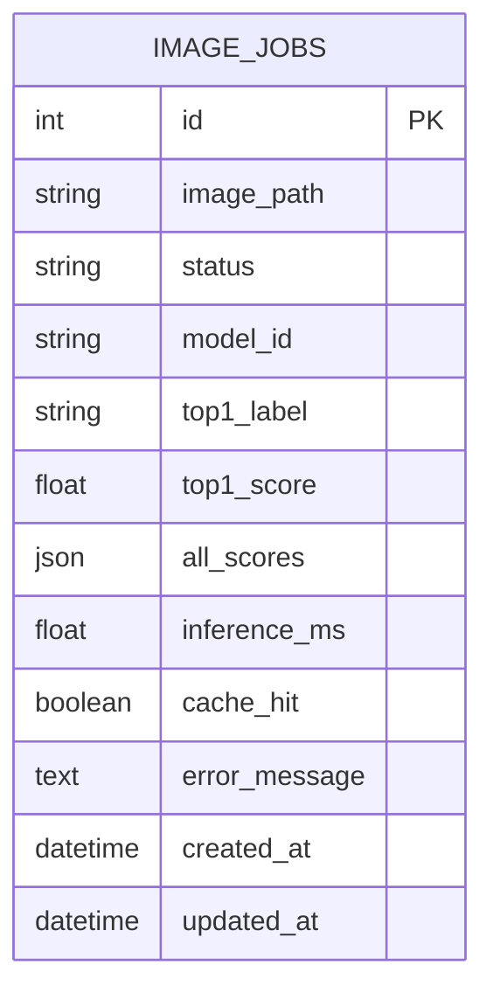
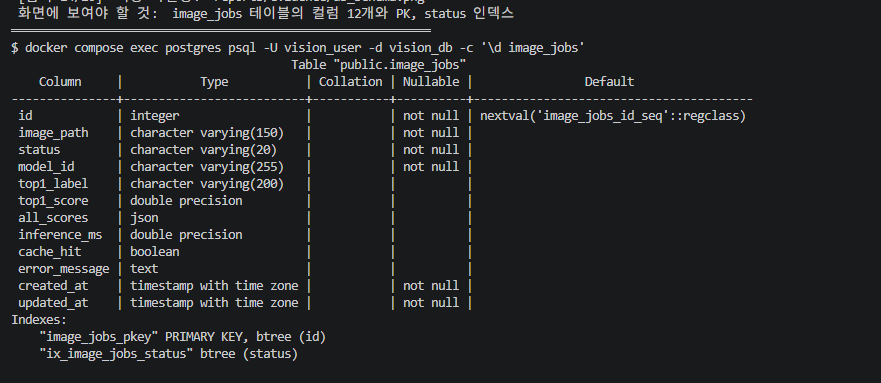
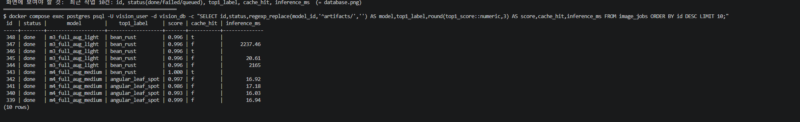

# 04. 데이터베이스 구조 및 작업이력

**DBMS:** PostgreSQL 17 (Docker `postgres:17-alpine`) · **DB:** `vision_db` · **테이블:** `image_jobs` · **PK:** `id`
**저장 대상:** 비동기 추론 작업의 상태와 분류 결과. 사진 원본은 DB가 아니라 `media/jobs/<uuid>.bin`에 저장한다.

실제 스키마 출력: [evidence/db_schema.txt](evidence/db_schema.txt) · 이 보고서의 작업 이력: [evidence/db_rows.txt](evidence/db_rows.txt)

## 1. ERD



테이블은 하나뿐이며 FK·관계 테이블은 없다.

## 2. 컬럼 정의 (실제 `\d image_jobs` 기준)

| 컬럼 | DB 자료형 | Nullable | 인덱스 | 용도 |
|---|---|---|---|---|
| `id` | integer | NOT NULL | **PK** (`image_jobs_pkey`) | 작업번호 (시퀀스 자동 증가) |
| `image_path` | varchar(150) | NOT NULL | | `media/jobs/` 안의 파일명 (서버가 만든 uuid) |
| `status` | varchar(20) | NOT NULL | `ix_image_jobs_status` | `queued` / `running` / `done` / `failed` |
| `model_id` | varchar(255) | NOT NULL | | 추론에 사용한 `MODEL_PATH` |
| `top1_label` | varchar(200) | NULL 허용 | | 1등 라벨 (완료 전·실패 시 NULL) |
| `top1_score` | double precision | NULL 허용 | | 1등 확률 |
| `all_scores` | json | NULL 허용 | | 전체 순위 `[{label, score}, ...]` |
| `inference_ms` | double precision | NULL 허용 | | 실제 모델 추론시간. **캐시 HIT면 NULL** |
| `cache_hit` | boolean | NULL 허용 | | 캐시 재사용 여부 |
| `error_message` | text | NULL 허용 | | 실패 원인 |
| `created_at` | timestamptz | NOT NULL | | 생성 시각 (UTC) |
| `updated_at` | timestamptz | NOT NULL | | 마지막 갱신 시각 (UTC) |

> **기본값에 관한 정확한 설명:** `status="queued"`, `created_at=현재 UTC` 같은 기본값은 SQLAlchemy 모델(`ai/models.py`)의 **`default=`**로 파이썬 쪽에서 채운다. 실제 DB 컬럼에는 서버 측 `DEFAULT`가 없다(`\d` 출력의 Default 칸은 `id`의 시퀀스 외에는 비어 있음). SQL로 직접 행을 넣으면 값을 직접 지정해야 한다.

## 3. 작업이력 조회

```sql
SELECT id, status, regexp_replace(model_id,'^artifacts/','') AS model, top1_label,
       round(top1_score::numeric,3) AS score, cache_hit, inference_ms,
       left(coalesce(error_message,''),32) AS error
FROM image_jobs WHERE id > 263 ORDER BY id;
```

최종 모델(`m3_full_aug_light`)로 설정한 뒤 수행한 시험·측정의 기록이 **id 264~290, 27건**이다(`done` 26건, `failed` 1건: [evidence/db_status_count.txt](evidence/db_status_count.txt)). id 263 이하는 이전 시험(모델 전환·이름 정리 중의 비교 실험)이라 이 보고서의 근거로 쓰지 않으며, DB는 지우지 않고 그대로 두었다.

| id | status | cache_hit | inference_ms | 무엇을 하다 생긴 기록인가 |
|---:|---|---|---:|---|
| 264 | done | false | 2112.65 | 기능 시험 T-03·T-04 (서비스 모델 전환 직후 **첫 추론: 모델 로딩 포함**) |
| 265 | done | false | 2110.90 | T-11: Worker를 멈춘 채 접수 → `queued` 유지 → 재시작 후 처리 (재시작 후 첫 추론이라 로딩 포함) |
| **266** | **failed** | NULL | NULL | **T-12: Redis 중지 상태에서 접수 → 큐 등록 실패** (`error_message` 기록) |
| 267 | done | false | 17.36 | T-14: Redis 복구 후 정상 처리 |
| 268~278 | done | false/true 쌍 | 약 16~20 / NULL | 성능 측정 **1회차** (워밍업 1건 + MISS→HIT 5쌍). 같은 조건으로 재실행했고 그 결과를 06에 사용 |
| 279~289 | done | false/true 쌍 | 약 17~18 / NULL | 성능 측정 **2회차** (06에 사용). 279는 워밍업, 280~289는 MISS→HIT 5쌍 |
| 290 | done | **true** | NULL | API 응답 원문 수집: 같은 사진을 동기로 먼저 분류해 캐시된 상태 → Worker가 캐시 HIT로 기록 |

- 모든 행의 `model_id`는 `artifacts/m3_full_aug_light`이다.
- MISS 처리 건의 `inference_ms`는 약 16~20ms, 캐시 HIT 건은 NULL이다. NULL은 "추론 생략"이지 0ms가 아니다.
- 동기 요청은 이 테이블에 **기록되지 않는다.** 시험 T-02에서 동기 호출을 3번 해도 다음 비동기 작업이 번호를 이어서 받았다(263 → 264).

## 4. 상태 전이

```
queued ──(Worker가 작업 수신)──▶ running ──▶ done
   │                                   └──▶ failed (추론 중 예외, error_message 기록)
   └──(큐 등록 실패)──────────────────────────▶ failed (web이 직접 기록)
```

- **실제로 관찰한 전이:** `queued → done`(정상), `queued → failed`(Redis 중지, id 266), `queued` 유지(Worker 중지, id 265).
- **`running` 상태는 직접 관찰하지 못했다.** 추론이 약 17ms로 끝나 상태 조회 간격(20~200ms)보다 짧기 때문이다. 정상 완료는 최종 `done`·DB·워커 로그([evidence/celery_worker_log.txt](evidence/celery_worker_log.txt))로 판정했다.
- **`queued` 유지:** Worker를 멈춘 뒤 접수한 작업(id 265)은 5초 뒤에도 `queued`였고, Worker를 다시 시작하자 `done`이 되었다. 이 결과가 항상 보장된다는 뜻은 아니며, 이번에 관찰한 결과이다.
- **Worker 안의 추론 중 예외로 `failed`가 되는 경로**는 실환경에서는 발생시키지 못했다. 모의 테스트(`test_worker_failure_records_failed`)로만 검증했다.

## 5. 저장 위치

| 데이터 | 위치 |
|---|---|
| 작업 상태·결과 | PostgreSQL `image_jobs` (Docker 볼륨 `postgres_data`) |
| 업로드 사진 | `media/jobs/<uuid>.bin` (호스트 폴더를 web·worker가 공유) |
| 캐시 | Redis DB/1, 키 형식 `vision:classify:<모델경로 해시 16자>:<사진 SHA-256>`, TTL 600초 ([evidence/redis_cache_keys.txt](evidence/redis_cache_keys.txt)) |
| 시각 | UTC로 저장 (예: `05:49:06+00` = 한국시간 14:49:06) |

## 6. 점검

- 존재하지 않는 FK나 관계 테이블을 만들지 않았다.
- `failed` 행은 실제로 관찰했다(id 266). 샘플의 임의 값을 쓰지 않았다.
- 증빙: `psql` 실행 화면 캡처(`evidence/db_schema.png`, `evidence/db_rows.png`)와 텍스트 원본([db_schema.txt](evidence/db_schema.txt), [db_rows.txt](evidence/db_rows.txt)). DBeaver 같은 GUI 도구는 쓰지 않았다.
- `db_rows.png`는 **이후 실행의 최근 10건**이라 작업 번호가 339~348이고, 비교 콘솔에서 ④로 처리한 작업(339~343)이 섞여 있다. 본문 표의 작업 264~290은 `db_rows.txt`에 있다. `done`·캐시 HIT(`t`, `inference_ms` 비어 있음)·콜드 스타트(2,000ms대) 행이 모두 보인다.




