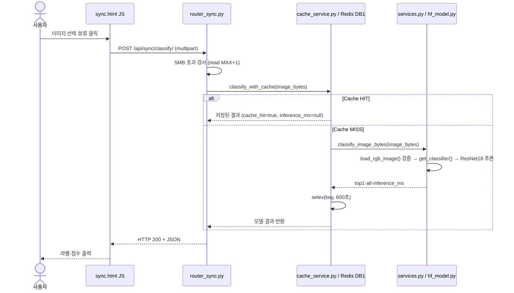
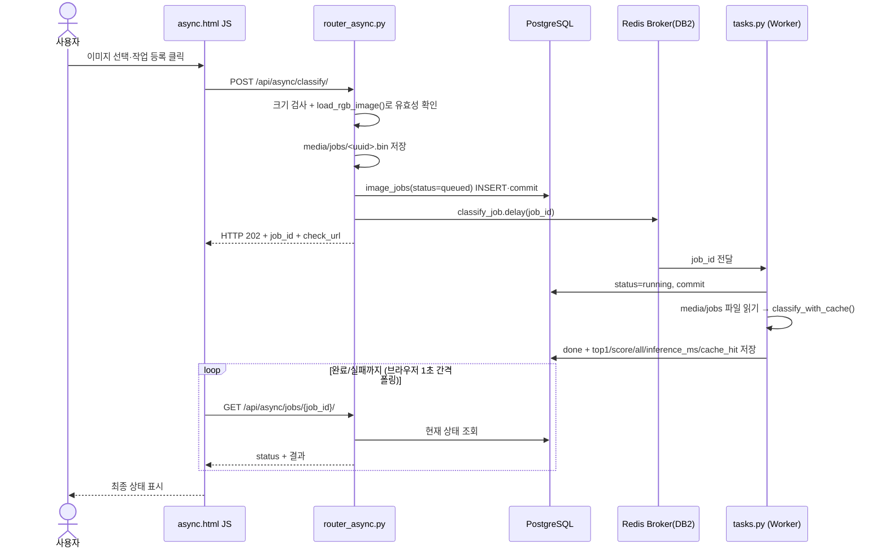
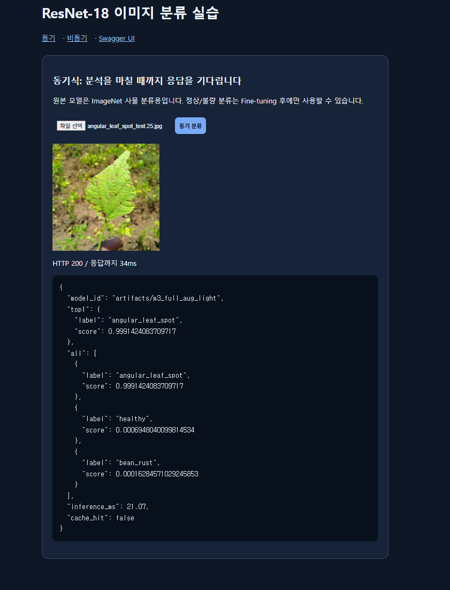
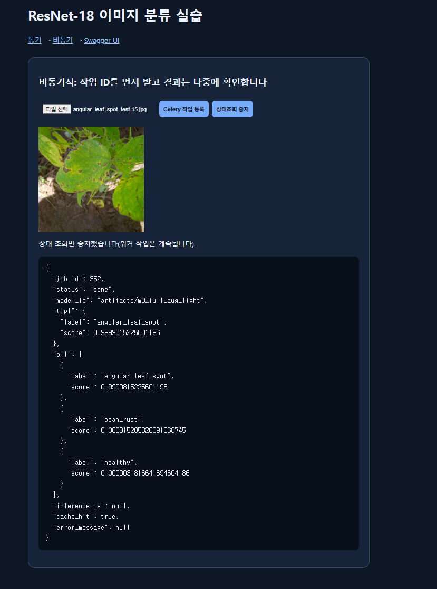
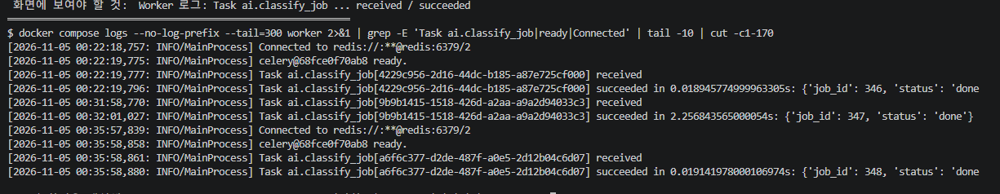

# 05. AI 분석 버튼 처리 파이프라인

버튼을 누른 순간부터 응답까지 실행되는 **파일·함수·데이터 흐름**을 실제 코드(`templates/`, `ai/`)와 대응시킨다.
실행 근거: [07 기능테스트](07_기능테스트_오류분석.md), 워커 로그 [evidence/celery_worker_log.txt](evidence/celery_worker_log.txt)

## A. 동기 버튼 클릭 시퀀스

## B. 비동기 버튼 클릭 시퀀스

## C. 실제 코드 연결표

| 단계 | 시작 파일 | 핵심 함수·처리 | 반환 / 다음 단계 |
|---|---|---|---|
| 동기 1 | `templates/sync.html` | `fetch('/api/sync/classify/')` | multipart로 이미지 전송 |
| 동기 2 | `ai/router_sync.py` | `classify_sync()` | 크기 검사 → `classify_with_cache()` |
| 동기 3 | `ai/cache_service.py` | `classify_with_cache()` | `cache_key()`로 키 생성 → Redis `get` → HIT면 즉시 반환 |
| 동기 4 | `ai/services.py` | `classify_image_bytes()` · `load_rgb_image()` | 검증·추론, `top1`·`all`·`inference_ms` |
| 동기 5 | `ai/hf_model.py` | `get_classifier()` (`lru_cache`) | 프로세스당 1회 모델 로드 후 재사용 |
| 비동기 1 | `templates/async.html` | `fetch('/api/async/classify/')` + 폴링 루프 | 202 후 `check_url`을 1초마다 조회 |
| 비동기 2 | `ai/router_async.py` | `enqueue_classify()` | 파일 저장 → DB `queued` → `classify_job.delay()` → 202 |
| 비동기 3 | `ai/celery_app.py` | `Celery(... broker=DB2, backend=DB3, include=["ai.tasks"])` | 작업을 Redis 큐로 전달 |
| 비동기 4 | `ai/tasks.py` | `classify_job()` | DB `running` → 추론(캐시 우선) → `done`/`failed` |
| 비동기 5 | `ai/router_async.py` | `get_job()` | 상태·예측 JSON, 없는 id면 404 |

## D. 실행으로 확인한 단계별 근거

| 확인 내용 | 근거 |
|---|---|
| 동기 응답에 결과가 포함된다 | `POST /api/sync/classify/` → 200 + `top1`·`all` (T-02) |
| 같은 이미지 재요청은 추론을 생략한다 | `cache_hit` false → true, `inference_ms` 18.5 → null (T-09) |
| 비동기는 접수 시점에 결과가 없다 | 202 + `status=queued`만 반환 (T-03) |
| 별도 프로세스(Worker)가 처리한다 | 워커 로그: `Task ai.classify_job[...] received` → `succeeded` |
| 워커가 없으면 작업이 처리되지 않는다 | Worker 중지 → 5초 후에도 `queued`, 재시작 후 `done` (T-11, T-11b) |
| 큐 등록 실패는 사용자에게 알려진다 | Redis 중지 → HTTP 503 + DB `failed` (T-12) |

## E. 비교 결론

- **동기:** HTTP 응답을 받을 때 추론 결과가 이미 포함된다. 요청이 추론이 끝날 때까지 열려 있다.
- **비동기:** HTTP 202 접수 후 `job_id`로 별도 조회가 필요하다. 추론은 다른 프로세스에서 일어난다.
- **분류 자체를 수행하는 ResNet18 모델은 동일하다.** 다만 web과 worker 각각 별도 프로세스에 모델이 로드된다.
- 이번 측정에서는 모델 추론이 약 17ms로 빨라서, 비동기는 **접수 응답은 빠르지만 최종 결과 확인은 오히려 느렸다** ([06 성능비교](06_성능비교_보고서.md)). 비동기의 이점은 추론이 오래 걸리거나 요청이 몰릴 때 나타난다.

## F. 증빙

- 실행 화면 캡처 (보고서 본문의 시험과 별도로 한 번 더 실행하며 찍은 화면이라 `job_id`·추론시간 같은 숫자는 본문과 다를 수 있다. 확인할 것은 상태코드·응답 구조·동작 결과이다.)

- 워커 로그: [evidence/celery_worker_log.txt](evidence/celery_worker_log.txt) (시각은 컨테이너 기준 UTC)
- 컨테이너 상태: [evidence/docker_compose_ps.txt](evidence/docker_compose_ps.txt)
