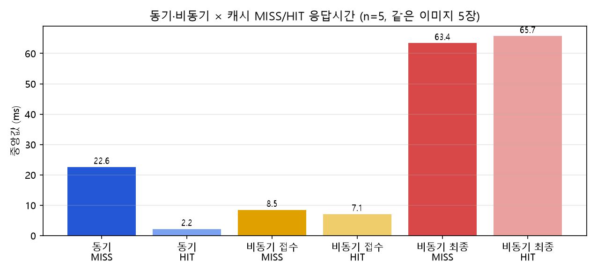

# 06. 성능 측정 및 비교 보고서

원본 측정값: [data/timings.csv](data/timings.csv) · 요약: [data/timings_summary.json](data/timings_summary.json) · 측정 스크립트: `scripts/measure_timings.py`
동시 요청 실험: [data/burst_compare.json](data/burst_compare.json) · `scripts/measure_burst.py` (비교 콘솔 `demo.py`의 API 사용)

## 1. 실험 조건

| 조건 | 기입 값 |
|---|---|
| 사진 | Test 폴더의 **같은 사진 5장**을 4개 조건(동기 MISS/HIT, 비동기 MISS/HIT)에 모두 사용 (angular_leaf_spot 36·37, bean_rust 36·37, healthy 36) |
| 모델 | `artifacts/m3_full_aug_light` (서비스 모델) |
| 실행환경 | WSL2 Ubuntu, Intel i7-12700, RAM 15GiB. web·worker·redis·postgres 모두 Docker. **추론은 CPU** (컨테이너 torch 2.5.1+cpu) |
| 클라이언트 | 같은 PC의 파이썬(`httpx`)에서 `127.0.0.1:8000`으로 요청 (네트워크 지연 없음) |
| 반복 | 조건별 **5회** (사진 5장 × 1회) |
| 캐시 | **MISS:** 요청 직전에 Redis 캐시 DB/1만 비워 실제 추론을 강제 · **HIT:** MISS 직후 같은 사진을 재요청. 모든 응답의 `cache_hit` 값이 의도와 일치함을 확인 |
| Worker | `solo`, `concurrency=1` |
| 워밍업 | 첫 실행(run_id=0)은 별도 기록하고 비교에서 **제외** |
| 비동기 최종 시간 | 요청 시작 → 상태조회가 `done`이 될 때까지. **50ms 간격 폴링을 포함** |

측정은 같은 조건으로 두 번 실행했고(작업 번호 268~278, 279~289), 두 번째 결과를 `timings.csv`에 저장해 사용했다. 첫 번째는 출력 확인에 실패해 다시 실행했다.

## 2. 원본 측정표 (모두 ms)

| 사진 | 동기 응답 (MISS) | 동기 응답 (HIT) | 비동기 접수 (MISS) | 비동기 최종 (MISS) | 비동기 접수 (HIT) | 비동기 최종 (HIT) |
|---|---:|---:|---:|---:|---:|---:|
| 1 angular_leaf_spot.36 | 22.6 | 2.0 | 7.7 | 63.3 | 6.5 | 64.8 |
| 2 bean_rust.36 | 22.5 | 2.5 | 9.5 | 65.1 | 6.8 | 65.7 |
| 3 healthy.36 | 24.9 | 2.2 | 7.7 | 62.7 | 7.2 | 66.2 |
| 4 angular_leaf_spot.37 | 22.6 | 2.0 | 9.0 | 63.8 | 7.1 | 63.1 |
| 5 bean_rust.37 | 22.7 | 2.2 | 8.5 | 63.4 | 7.1 | 66.3 |
| **중앙값** | **22.6** | **2.2** | **8.5** | **63.4** | **7.1** | **65.7** |
| 평균 | 23.1 | 2.2 | 8.5 | 63.7 | 6.9 | 65.2 |

**서버가 기록한 실제 추론시간 `inference_ms` (중앙값):** 동기 MISS 17.8ms · 비동기 MISS 17.6ms · 캐시 HIT는 **NULL** (추론 생략)

**워밍업 (비교 제외, run_id=0):** 동기 23.3ms · 비동기 최종 65.3ms. 측정 직전에 worker가 이미 모델을 불러 둔 상태였다. **콜드 스타트는 별도로 관찰했다:** 서비스 모델 전환 직후 첫 비동기 작업(id 264)과 Worker 재시작 뒤 첫 작업(id 265)의 `inference_ms`가 각각 2,112.65ms, 2,110.90ms였다. 이후 추론은 약 17ms이므로 **프로세스의 첫 추론은 약 120배 느리다.**



## 3. 계산

```text
비동기 접수 응답 단축률 = (22.6 - 8.5) / 22.6 × 100 = 62.4 %   (동기 MISS 응답 대비 비동기 MISS 접수)
전체 결과 확인시간 차이 = 63.4 - 22.6 = 40.8 ms                (비동기 최종 확인이 더 느림)
동기 캐시 효과          = (22.6 - 2.2) / 22.6 × 100 = 90.3 %   (MISS 대비 HIT)
비동기 최종의 캐시 효과 = 65.7 - 63.4 = +2.3 ms                (구분할 수 없는 크기)
```

## 4. 캐시 비교표 (중앙값, ms)

| 경로 | 캐시 | HTTP 응답 | 최종 확인 | 서버 추론시간 | 메모 |
|---|---|---:|---:|---:|---|
| 동기 | MISS | 22.6 | 22.6 | 17.8 | 모델 실제 추론 |
| 동기 | HIT | 2.2 | 2.2 | NULL | 추론 생략 |
| 비동기 | MISS | 8.5 (접수) | 63.4 | 17.6 | 접수와 처리 분리 |
| 비동기 | HIT | 7.1 (접수) | 65.7 | NULL | Worker도 추론을 생략 |

## 5. 동시 요청 실험 (20건을 한꺼번에, 사진은 클래스 균형 무작위·시드 7)

비교 콘솔의 "동시" 모드로 측정했다. 정확도는 동기·비동기 모두 20/20, 예측 라벨 일치 20/20이다.

| 조건 | 구분 | 요청별 응답 중앙값 / 최대 | 전체 접수 완료 | 전체 완료 |
|---|---|---:|---:|---:|
| MISS | 동기 | 255.6 / 275.2 ms | – | **284.9 ms** |
| MISS | 비동기 | 접수 247.9 / 373.9 ms (최종 501.5 / 713.3 ms) | 383.2 ms | **743.9 ms** |
| HIT | 동기 | 17.5 / 28.6 ms | – | **31.1 ms** |
| HIT | 비동기 | 접수 98.6 / 109.3 ms (최종 135.2 / 180.9 ms) | 113.5 ms | **212.5 ms** |

- 동시에 몰려도 **비동기의 접수 응답이 동기 응답보다 빠르지 않았다**(MISS: 247.9 vs 255.6ms). 접수 단계에서도 web이 사진 검증·파일 저장·DB 기록·큐 등록을 하기 때문이다.
- 동기 MISS의 서버 추론시간 중앙값은 193.2ms로, 단건(약 17ms)보다 크다. 20건이 한 프로세스의 CPU를 나눠 쓰기 때문이다.
- 비동기는 worker가 1개(solo)라 처리는 순서대로 진행되어 전체 완료가 더 늦었다.

## 6. 해석

1. **정확도는 방식과 무관했다.** 순차·동시 모두 동기와 비동기의 예측 라벨이 100% 같았다. 같은 모델이 같은 사진을 처리하기 때문이다.
2. **비동기 접수 응답은 동기 응답보다 62.4% 빨랐지만(순차), 결과를 받기까지는 40.8ms 더 걸렸다.** 이는 모델이 빨라진 것이 아니라 **접수와 처리를 분리한 효과**이다.
3. 이 모델은 추론이 약 17ms로 매우 빨라서, 큐를 거치는 시간과 상태조회 간격(50ms)이 추론시간보다 크다. 그래서 비동기의 이점이 드러나지 않았다. **비동기는 추론이 오래 걸리거나 처리를 기다리는 동안 web이 다른 일을 해야 할 때 의미가 있으며, 이번 측정은 그 상황이 아니다.**
4. 비동기 최종 시간(약 63~66ms)은 캐시 여부와 거의 무관했다(HIT와 MISS가 2.3ms 차이). **측정 해상도가 폴링 간격(50ms)에 제한된다**는 뜻이므로 "캐시가 비동기 처리를 빠르게 하지 않는다"고 결론짓지 않는다.
5. **캐시 HIT는 동기에서 뚜렷했다**(22.6 → 2.2ms, 90.3% 감소). 동시 실험에서도 동기 HIT가 비동기 HIT보다 빨랐다(전체 31.1 vs 212.5ms): 캐시 조회만 하면 되는 요청에서는 큐를 거치는 비용이 그대로 드러난다.
6. **콜드 스타트:** 프로세스별 첫 추론은 약 2.1초였다.

## 7. 비교 조건 점검

- [x] 같은 모델(`m3_full_aug_light`)로 측정
- [x] MISS 대 MISS, HIT 대 HIT를 구분하고 `cache_hit` 응답값으로 확인
- [x] 같은 사진 5장, 같은 PC·하드웨어
- [x] 모델 첫 로딩(워밍업)을 별도 기록하고 비교에서 제외
- [x] 반복 원본값(`timings.csv`)과 요약표 일치 (중앙값·평균을 CSV에서 다시 계산해 대조)

## 8. 한계

- **반복 5회**라 통계적 신뢰구간은 제시하지 않는다. 값은 이 PC의 이 시점에 대한 관측이다.
- **클라이언트와 서버가 같은 PC**여서 실제 네트워크 지연이 없다.
- 컨테이너가 **CPU로 추론**한 결과이다. GPU를 쓰면 추론시간이 달라질 수 있다(측정하지 않음).
- 비동기 최종 시간은 폴링 간격(50ms)에 의존한다. 간격을 줄이면 값이 줄어들 수 있다(측정하지 않음).
- 동시 실험은 20건 1회씩만 측정했다. 부하를 더 높인 경우는 측정하지 않았다.

> **성능 향상 주장 규칙:** 이 문서는 "비동기가 빠르다"고 주장하지 않는다. 비동기 HTTP 접수시간, 전체 결과 확인시간, 모델 Accuracy는 서로 다른 지표이다.
