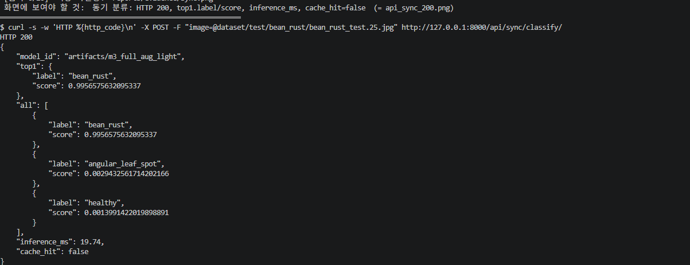
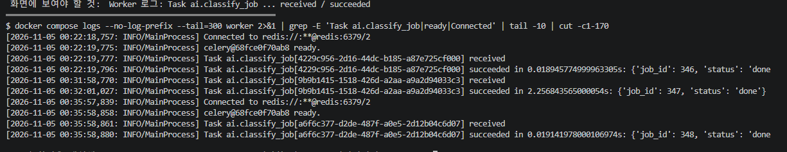
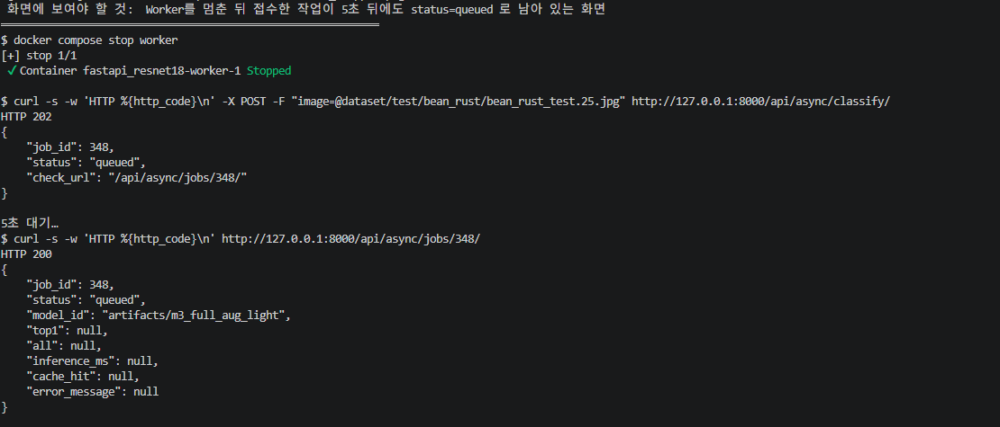

# 07. 기능 테스트 및 오류 분석 기록서

실행 스크립트: `scripts/functional_tests.py` · 원본 결과: [data/functional_results.json](data/functional_results.json) · 실행 로그: [evidence/functional_tests.log](evidence/functional_tests.log)
실행 일시: 2026-11-04 16:54 (KST) · 대상: Docker Compose 4개 서비스, 서비스 모델 `artifacts/m3_full_aug_light`

## 1. 테스트 결과: 23건 중 23건 PASS

| Test ID | 확인 항목 | 테스트 입력·절차 | 기대 결과 | 실제 결과 | 판정 |
|---|---|---|---|---|---|
| T-01 | FastAPI 헬스 | `GET /health` | 200 / ok | 200 / `{"status":"ok"}` | PASS |
| T-02a | 동기 추론 (angular_leaf_spot) | Test 사진 업로드 | 200 / 정답 라벨 | 200 / angular_leaf_spot (1.000) | PASS |
| T-02b | 동기 추론 (bean_rust) | Test 사진 업로드 | 200 / 정답 라벨 | 200 / bean_rust (0.998) | PASS |
| T-02c | 동기 추론 (healthy) | Test 사진 업로드 | 200 / 정답 라벨 | 200 / healthy (1.000) | PASS |
| T-03 | 비동기 접수 | `POST /api/async/classify/` | 202 / job_id / queued | 202 / job_id=264 / queued | PASS |
| T-04 | 비동기 완료 | `GET /api/async/jobs/264/` 폴링 | 200 / done / bean_rust | done / bean_rust / cache_hit=false | PASS |
| T-05 | Redis 연결 | `redis-cli ping` | PONG | PONG | PASS |
| T-06 | DB 기록 | `image_jobs` 조회 | id=264, done | `264 \| done \| m3_full_aug_light \| bean_rust \| 0.9946 \| f \| 2112.65` | PASS |
| T-07 | 불량 입력 | `.txt` 파일을 sync·async에 업로드 | 400 | sync 400 `올바른 이미지 파일이 아닙니다.` / async 400 | PASS |
| T-08 | 없는 작업번호 | `GET /api/async/jobs/999999/` | 404 | 404 `해당 작업이 없습니다.` | PASS |
| T-09 | 캐시 반복 | 캐시를 비우고 같은 파일 2회 | MISS → HIT | cache_hit false → true, inference_ms 18.5 → null | PASS |
| T-10 | 용량 초과 | 5MB+1바이트 업로드 | 413 | sync 413 / async 413 | PASS |
| T-11 | Worker 미실행 | worker 정지 후 접수, 5초 대기 | 접수 202, queued 유지 | 202, 5초 뒤 `queued`, DB `265\|queued` | PASS |
| T-11b | Worker 재시작 후 | 같은 job_id 재조회 | (관찰 기록) | `done` (angular_leaf_spot) | PASS |
| T-12 | Redis 장애: 비동기 | redis 정지 후 비동기 접수 | 503 + failed 기록 | **503 (20.1초 소요)**, DB `266\|failed\|작업 큐 등록 실패...` | PASS |
| T-13 | Redis 장애: 동기 | redis 정지 상태에서 동기 요청 | 200 (캐시 없이 추론) | 200 / bean_rust / cache_hit=false | PASS |
| T-14 | Redis 복구 후 | redis 재시작 후 비동기 | 202 → done | 202 → done | PASS |
| T-15a~d | 화면·정적 파일 | `/vision/sync/`, `/vision/async/`, `/docs`, `/static/style.css` | 200 | 모두 200 | PASS |
| T-16 | 모의 테스트(로컬) | `python -m pytest -q` | 4 passed | 4 passed | PASS |
| T-17 | 모의 테스트(컨테이너) | `docker compose exec web pytest -q tests/test_api.py` | 4 passed | 4 passed | PASS |

증빙: [functional_tests.log](evidence/functional_tests.log) · [db_job_row.txt](evidence/db_job_row.txt) · [db_rows.txt](evidence/db_rows.txt) · [api_samples.txt](evidence/api_samples.txt) · [celery_worker_log.txt](evidence/celery_worker_log.txt) · [docker_compose_ps.txt](evidence/docker_compose_ps.txt)

> T-11, T-12는 **서비스를 일부러 멈춰서** 수행했고, 시험이 끝난 뒤 worker와 redis를 복구했다(T-14로 복구 확인).

## 2. 테스트 구분

| 구분 | 해당 항목 | 의미 |
|---|---|---|
| **실환경 통합 테스트** | T-01~T-15 | 실제 ResNet18 모델, Redis, PostgreSQL, Celery Worker, Docker 네트워크를 거친 호출 |
| **단위·모의 테스트** | T-16, T-17 | 가짜 모델·가짜 Redis·SQLite를 쓴 함수·HTTP 응답 검증 (`tests/test_api.py`, 4개) |

모의 테스트가 PASS여도 **실환경 PASS로 간주하지 않았다.** 모의 테스트는 실제 추론 정확도, 실제 Redis/Celery/PostgreSQL 연동, Docker 네트워크를 검증하지 않는다.

## 3. 실제로 겪은 오류 이력

| 오류 ID | 현상 | 원인 확인 | 조치 | 재검증 | 결과 |
|---|---|---|---|---|---|
| E-01 | `python3.11: command not found` | Ubuntu에 3.11이 설치되어 있지 않음 (3.12·3.14만 있음) | `uv venv --python 3.11 .venv`로 3.11 환경 생성 | `python --version` → 3.11.17 | 해결 |
| E-02 | `No module named pip` | `uv`로 만든 가상환경에는 pip가 없음 | `python3.11 -m venv`로 재생성 후 pip 사용 | `pip install -r requirements.txt` 성공 | 해결 |
| E-03 | `Could not open requirements file` | `requirements.txt`를 만들기 전에 설치 명령을 실행 | 문서의 코드로 파일 생성 후 설치 | torch·transformers 등 설치 확인 | 해결 |
| E-04 | `dataset/val` 폴더 없음 | 제공 데이터의 폴더명이 `validation`인데 학습 코드는 `val`을 읽음 | `mv dataset/validation dataset/val` | 학습 실행 시 Val 133장 인식 | 해결 |
| E-05 | `docker could not be found in this WSL 2 distro` | Docker Desktop이 꺼져 있었음 | Docker Desktop 실행 후 대기 | `docker info` 정상, `docker compose up` 성공 | 해결 |
| E-06 | 컨테이너에서 `pytest` 실행 시 `No module named 'ai'` | `pytest` 명령은 프로젝트 루트를 import 경로에 넣지 않음 | 루트에 `pytest.ini`(`pythonpath = .`) 추가, 이미지 재빌드 | 컨테이너·로컬 모두 4 passed (T-16, T-17) | 해결 |
| E-07 | `./run.sh: No such file or directory` | 프로젝트 폴더가 아니라 홈 폴더(`~`)에서 실행함 | `cd ~/fastapi_resnet18` 후 실행 | 비교 콘솔이 정상 기동 | 해결 |
| E-08 | 비교 콘솔 시험 중 `address already in use` (포트 8200) | 이전에 띄운 콘솔이 같은 포트를 점유 | 시험은 `--port 8201`로 수행, 옛 콘솔은 종료 후 재실행 | 새 콘솔 정상 기동 | 해결 |

- E-01~E-03은 환경 구성 중, E-04는 데이터 배치 중, E-05·E-06은 서비스 실행·테스트 중, E-07·E-08은 비교 콘솔 실행 중 실제로 발생했다.

## 4. 시험 중 관찰한 주의 사항 (오류는 아니지만 기록)

| 번호 | 관찰 | 의미·권고 |
|---|---|---|
| O-01 | **Redis가 꺼진 상태에서 비동기 접수가 503을 돌려주기까지 20.1초**가 걸렸다 | 응답은 올바르지만 사용자는 20초 기다린다. 브로커 연결 재시도 시간을 줄이는 설정(`broker_transport_options` 등)이 필요할 수 있다. **이번 작업에서 수정하지 않았다.** |
| O-02 | Redis가 꺼져도 **동기 API는 200**을 반환한다 (캐시 없이 추론) | 캐시를 필수 의존성이 아닌 최적화로 설계한 코드(`try/except` 폴백)가 의도대로 동작함 |
| O-03 | 서비스 모델 전환·Worker 재시작 뒤 첫 추론은 약 2.1초 (모델 로딩) | 콜드 스타트. 작업 264·265의 `inference_ms`, [06 문서](06_성능비교_보고서.md) 참조 |
| O-04 | `running` 상태를 직접 관찰하지 못했다 | 추론이 약 17ms라 폴링 간격보다 짧음. 완료 여부는 최종 `done`·DB·워커 로그로 판단 |

## 5. 실제로 발생시키지 못한 시나리오 (미실시)

| 시나리오 | 상태 | 비고 |
|---|---|---|
| Worker 내부 추론 중 예외로 `failed` 기록 | **실환경 미발생** | 모의 테스트(`test_worker_failure_records_failed`)에서만 검증 |
| PostgreSQL 중지 시 동작 | **미실시** | |
| 부하를 높인 동시 요청(20건 초과) | **미실시** | 20건 동시 실험은 [06 문서](06_성능비교_보고서.md) 5절 |
| 손상된 이미지(확장자는 jpg, 내용은 깨짐) | **미실시** | `.txt`만 시험 |

## 6. 증빙 캡처 (실행 화면)

실행 화면 캡처를 `reports/evidence/`에 첨부했다. (보고서 본문의 시험과 별도로 한 번 더 실행하며 찍은 화면이라 `job_id`·추론시간 같은 숫자는 본문과 다를 수 있다. 확인할 것은 상태코드·응답 구조·동작 결과이다.) 예를 들어 `done.png`의 작업 347은 서비스를 다시 시작한 직후의 첫 추론이라 `inference_ms`가 2,237ms이다(콜드 스타트, [06 문서](06_성능비교_보고서.md)).

| Test ID | 캡처 | 확인할 내용 |
|---|---|---|
| T-01 | [health.png](evidence/health.png) | HTTP 200 / `{"status":"ok"}` |
| T-02 | [sync.png](evidence/sync.png) | 동기 분류 HTTP 200, 라벨·점수 |
| T-03 | [enqueue.png](evidence/enqueue.png) | 비동기 접수 HTTP 202, job_id, queued |
| T-04 | [done.png](evidence/done.png) | 같은 작업이 `status=done` |
| T-05 | [redis.png](evidence/redis.png) | PONG, PostgreSQL accepting connections |
| T-06 | [db_rows.png](evidence/db_rows.png) | `image_jobs` 작업 이력 |
| T-07 | [bad_image.png](evidence/bad_image.png) | `.txt` 업로드 HTTP 400 |
| T-08 | [not_found.png](evidence/not_found.png) | 없는 작업번호 HTTP 404 |
| T-09 | [cache.png](evidence/cache.png) | 같은 사진 2회: MISS(`cache_hit=False`) → HIT(`inference_ms=None`) |
| T-11 | [worker_stopped.png](evidence/worker_stopped.png) · [worker_recovered.png](evidence/worker_recovered.png) | Worker 정지 후에도 `queued` 유지, 재시작 후 `done` (재시작 후 처리분은 이전 작업이 캐시되어 `cache_hit=true`) |
| T-16·T-17 | [pytest.png](evidence/pytest.png) | **모의(mock)** 테스트 4 passed (로컬·컨테이너) — 실환경 시험이 아님 |

**캡처가 없는 시험:** T-10(용량 초과 413), T-12~T-14(Redis 중지·복구), T-15(화면·정적 파일 200)는 화면 캡처 대신 텍스트 로그([evidence/functional_tests.log](evidence/functional_tests.log))로 증빙한다.

