# 콩잎 질병 분류 Vision AI API 서비스 기술보고서

> 이 문서는 산출물 1~7을 종합한 최종 보고서이다. 모든 수치는 실제 실행 결과이며 근거 파일 경로를 함께 적었다. 측정하지 않은 항목은 "미측정"으로 표기했다. 재현 방법은 [README](../README.md)를 따른다.

## 0. 한눈에 보는 결과

| 항목 | 결과 |
|---|---|
| 서비스 모델 | ③ `m3_full_aug_light` (Validation 최고 점수로 선택) |
| Test 정확도 (128장) | ① 0.7188 → ② 0.9688 (**+25.0%p**) · 서비스 모델 ③ 0.9609 |
| 동기 응답 (캐시 MISS / HIT) | 22.6 ms / **2.2 ms** (캐시로 90.3% 단축) |
| 비동기 접수 / 최종 확인 | **8.5 ms** / 63.4 ms (접수는 빠르지만 결과는 40.8 ms 늦음) |
| 동기·비동기 정확도 | 같음 (예측 라벨 일치 100%) |
| 기능 시험 | **23건 / 23건 PASS** (Worker·Redis 장애 시험 포함) |

**핵심 메시지 3가지**
1. 사전학습 ResNet18을 **분류 헤드만** 학습하면 Test 0.72에 그치지만, **전체 가중치**를 학습하면 0.97까지 올라간다.
2. 같은 모델을 **동기 API**와 **비동기(Celery) API**로 서비스하고, Redis 캐시와 PostgreSQL 작업 이력을 갖춘 4개 컨테이너 구조로 배포했다.
3. 측정 결과 비동기는 "빠른 처리"가 아니라 **"접수와 처리의 분리"**였다. 이 모델처럼 추론이 빠르면(약 17ms) 결과는 오히려 늦게 나온다. 반면 **캐시는 응답을 90% 줄였다.**

## 1. 프로젝트 정보

**목표**
- 콩잎 사진을 `angular_leaf_spot`(각진 잎 반점병) / `bean_rust`(녹병) / `healthy`(정상) 3가지로 분류하는 모델을 Fine-tuning한다.
- 이 모델을 API·캐시·작업 큐·DB를 갖춘 실제 서비스 구조로 배포한다.
- 동기와 비동기 방식이 실제로 어떻게 다른지 **같은 조건에서 숫자로** 비교한다.

**입출력:** JPG/PNG/WEBP (5MB 이하, 1,200만 픽셀 이하) → 3클래스 라벨과 확률(`top1`, `all`)

**기술 스택 및 실행 환경** (원본: [evidence/environment.txt](evidence/environment.txt))

| 구분 | 내용 |
|---|---|
| 기반 모델 | `microsoft/resnet-18` (ImageNet 1,000클래스 사전학습) → 출력층을 3클래스로 교체 |
| 학습 | WSL2 Ubuntu 호스트 `.venv`, Python 3.11.17, torch 2.15.0+cu132, transformers 4.57.6, **RTX 3060 12GB (GPU)** |
| 서빙 | FastAPI 0.162.0 · Celery 5.6.3 · SQLAlchemy 2.1.8 (컨테이너 Python 3.11.18, **torch 2.5.1+cpu**) |
| 캐시·브로커 | Redis 7.4 — DB1 캐시 · DB2 Celery 브로커 · DB3 결과 백엔드 |
| DB | PostgreSQL 17 (`image_jobs` 테이블) |
| 실행 | Docker Compose 4개 컨테이너 (`web`, `worker`, `redis`, `postgres`) |
| 하드웨어 | Windows 11 + WSL2, Intel Core i7-12700, WSL 메모리 15GiB |

## 2. 모델 학습 결과

### 2.1 데이터

| 클래스 | Train | Validation | Test |
|---|---:|---:|---:|
| angular_leaf_spot | 345 | 44 | 43 |
| bean_rust | 348 | 45 | 43 |
| healthy | 341 | 44 | 42 |
| **합계** | **1,034** | **133** | **128** |

- 총 1,295장이며 세 클래스가 거의 균등하다.
- **역할 분리:** Train으로 학습, Validation으로 모델 선택, **Test는 학습·선택에 쓰지 않고 마지막 평가에만** 사용했다.
- **누출 점검:** 전체 1,295장의 SHA-256 해시를 비교해 중복 0건, split 간 중복 0건을 확인했다. 단, 같은 잎을 다른 각도로 찍은 "유사 사진"은 해시로 찾을 수 없어 점검하지 못했다.
- 제공 원본 폴더명이 `validation`이었으나 학습 코드가 `val`을 읽어 폴더명을 맞췄다.

### 2.2 모델 4종과 학습 설정

모델 이름만 봐도 BASE에서 **무엇이 더해졌는지** 알 수 있게 단계적으로 설계했다.

| 모델 | BASE에서 더해진 것 | 에폭 | 배치 | lr | 증강 | 저장 시점 |
|---|---|---:|---:|---|---|---|
| ① `m1_head_only` | 출력층 교체 + **분류 헤드만** 학습 (Backbone 고정) | 3 | 8 | 2e-4 | 없음 | 2에폭 |
| ② `m2_full` | ① + **전체 가중치** 학습 | 10 | 16 | 1e-4 | 없음 | 4에폭 |
| ③ `m3_full_aug_light` | ② + **증강 light** | 10 | 16 | 1e-4 | 뒤집기 · 회전 ±15° · 밝기/대비 ±15% | 8에폭 |
| ④ `m4_full_aug_medium` | ② + **증강 medium** | 10 | 16 | 1e-4 | 확대 70~100% · 회전 ±30° · 밝기/대비 ±25% · 채도 ±10% | 5에폭 |

- 학습 코드는 **Validation 정확도가 최고인 에폭의 가중치만 저장**한다(마지막 에폭이 아님). 시드는 모두 42.
- 증강은 train에만 적용하고 val·test는 원본 그대로 평가했다. ③④는 ②와 증강만 다르다.
- ①→②는 학습 방식 외에 에폭·배치·학습률도 달라서 "전체 학습"의 효과만 따로 떼어 볼 수는 없다.

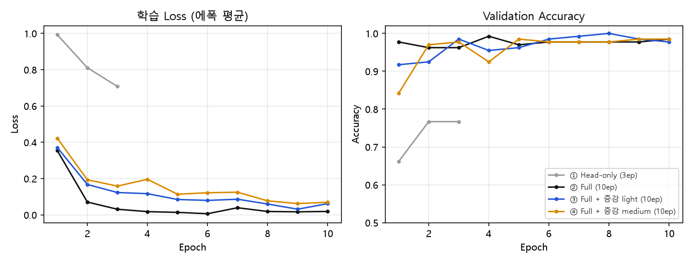

- ①은 3에폭 동안 Loss가 0.99 → 0.71로 천천히 줄고 Validation도 0.77에서 멈췄다. 특징 추출부가 고정되어 콩잎 병반을 구분할 표현을 새로 배우지 못했기 때문이다.
- ②③④는 1~2에폭 만에 Validation 0.92~0.98에 도달했다. 증강 모델(③④)은 학습 Loss가 더 높게 유지되는데, 매 에폭 조금씩 다른 사진을 보기 때문이다.

### 2.3 Test 평가와 모델 선택

| 모델 | Best Val | Test 정답 / 128 | Test Accuracy |
|---|---:|---:|---:|
| ① `m1_head_only` | 0.7669 | 92 | 0.7188 |
| ② `m2_full` | 0.9925 | 124 | 0.9688 |
| **③ `m3_full_aug_light` (서비스)** | **1.0000** | 123 | 0.9609 |
| ④ `m4_full_aug_medium` | 0.9850 | 124 | 0.9688 |

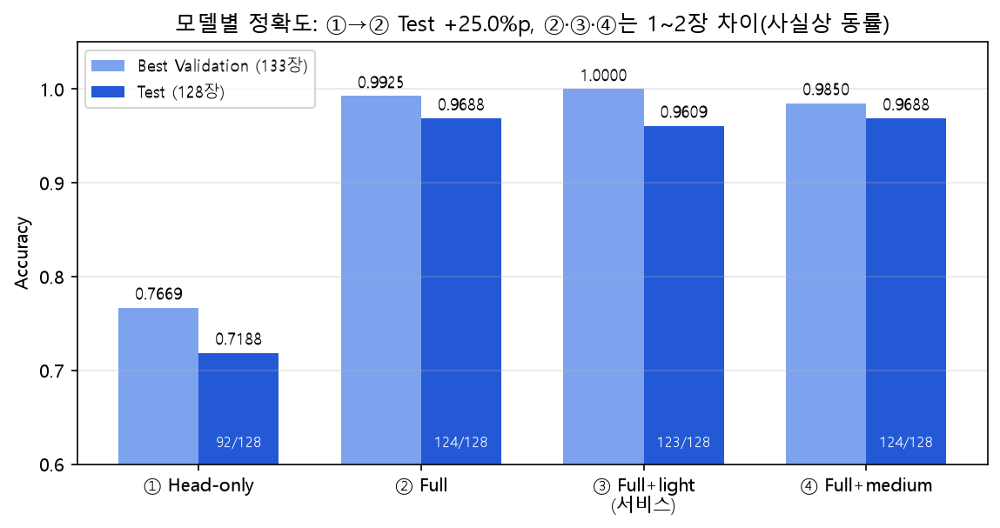

- ①→②에서 Test **+25.0%p**로 가장 큰 개선이 있었다.
- **선택 규칙:** 모델은 Validation 최고 점수로 고르고, Test는 확정 후 보고용으로만 쓴다. Test로 고르면 그 점수가 낙관적으로 부풀려지기 때문이다. 규칙에 따라 ③을 서비스 모델로 적용했다(`.env`의 `MODEL_PATH`).
- 단, ②③④는 Validation 최대 2장, Test 1장 차이라 **사실상 동률**이며 ③이 우월하다는 증거는 아니다. Test는 한 장이 0.78%p이다.
- Test 평가는 이 작업에서 추가한 `training/evaluate.py`로 측정했다(제공 코드에는 없음).

**클래스별 Precision / Recall / F1 (Test)**

| 클래스 | ① P / R / F1 | ② P / R / F1 | ③ P / R / F1 (서비스) | ④ P / R / F1 |
|---|---|---|---|---|
| angular_leaf_spot | 0.698 / 0.698 / 0.698 | 0.956 / 1.000 / 0.977 | 0.954 / 0.954 / 0.954 | 0.954 / 0.954 / 0.954 |
| bean_rust | 0.697 / **0.535** / 0.605 | 0.954 / 0.954 / 0.954 | 0.932 / 0.954 / 0.943 | 0.954 / 0.954 / 0.954 |
| healthy | 0.750 / 0.929 / 0.830 | 1.000 / 0.952 / 0.976 | 1.000 / 0.976 / 0.988 | 1.000 / 1.000 / 1.000 |

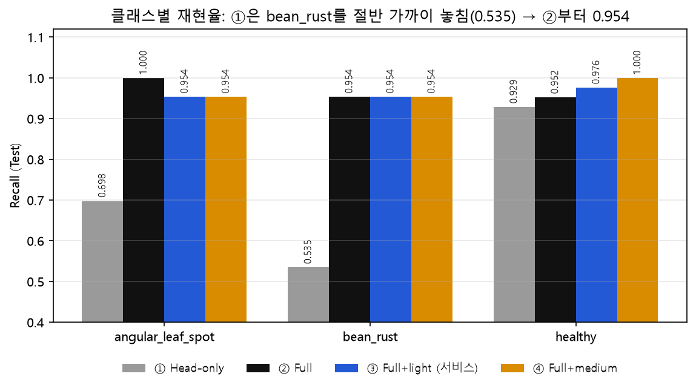

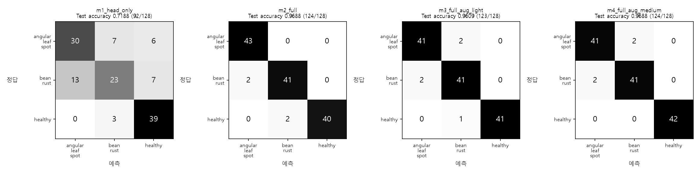

- ①은 `bean_rust`를 절반 가까이 놓쳤다(재현율 0.535). 43장 중 13장을 `angular_leaf_spot`으로 판정했다.
- ②부터는 세 클래스를 고르게 맞힌다. 남는 오답은 대부분 **`angular_leaf_spot` ↔ `bean_rust`** 사이에서 나온다. 두 병 모두 잎에 갈색·황색 반점이 생겨 겉모습이 비슷하기 때문이다.

**서비스 모델 ③의 오분류 5장**

| 파일 | 정답 | 예측 | 예측 확률 |
|---|---|---|---:|
| `angular_leaf_spot_test.36.jpg` | angular_leaf_spot | bean_rust | 0.71 |
| `angular_leaf_spot_test.42.jpg` | angular_leaf_spot | bean_rust | 0.77 |
| `bean_rust_test.15.jpg` | bean_rust | angular_leaf_spot | 0.97 |
| `bean_rust_test.36.jpg` | bean_rust | angular_leaf_spot | 0.62 |
| `healthy_test.35.jpg` | healthy | bean_rust | 0.49 |

- 5장 중 4장은 예측 확률이 0.8 미만이었다. 확률이 낮은 결과를 "확인 필요"로 돌리는 방안(8절 제안 2)의 근거가 될 수 있으나, 정답 사진의 확률 분포는 확인하지 않아 **임계값 효과는 측정하지 않았다.** `bean_rust_test.15`는 0.97로 확신하며 틀렸다.
- 원본: [data/misclassified_m3.json](data/misclassified_m3.json) (호스트에서 ③으로 재추론, 123/128로 혼동행렬과 일치)

### 2.4 데이터 증강 반복 실험

모델을 한 번씩만 학습하면 결과에 운이 섞인다. 그래서 **증강 3종 × 시드 3개 = 9회**를 반복 학습했다(공통: Full, 10에폭, 배치 16, lr 1e-4).

| 증강 | Val 평균 ± 표준편차 | Test 평균 ± 표준편차 | Test 범위 | 실행별 Test 정답 수 |
|---|---|---|---|---|
| none | 0.9900 ± 0.0043 | 0.9453 ± 0.0078 | 0.9375 ~ 0.9531 | 121 / 120 / 122 |
| light | 0.9950 ± 0.0043 | 0.9583 ± 0.0045 | 0.9531 ~ 0.9609 | 123 / 122 / 123 |
| medium | 0.9925 ± 0.0075 | 0.9792 ± 0.0045 | 0.9766 ~ 0.9844 | 126 / 125 / 125 |

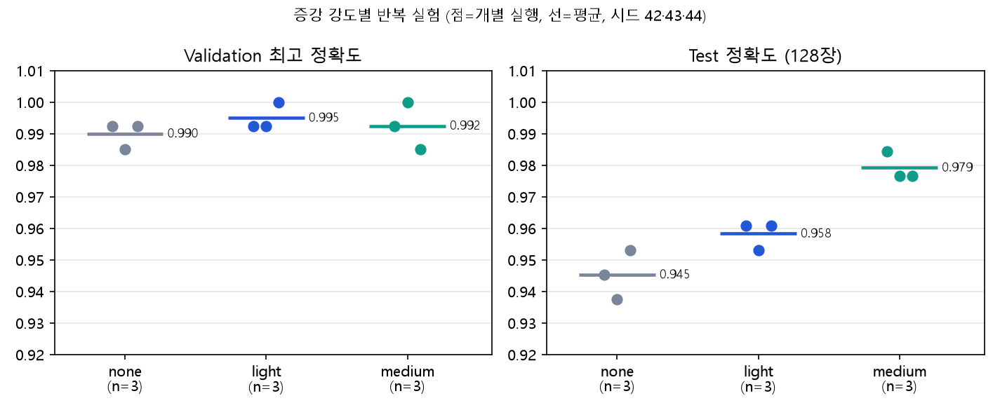

1. **Validation은 포화되어** 모든 실행이 0.985~1.000이라 증강을 구분하지 못했다.
2. Test에서는 증강이 강할수록 평균이 올랐다(0.945 → 0.958 → 0.979). `none`의 최고가 `medium`의 최저보다 낮아 두 설정은 범위가 겹치지 않는다.
3. 같은 시드로 다시 학습해도 최대 2장 흔들렸다(GPU 연산이 완전히 결정적이지 않음). **모델 한 개씩만 비교한 결과로 결론을 내리면 안 된다**는 뜻이다.
4. 이 비교에는 Test를 사용했으므로 낙관적이다. 결론은 **"증강이 Test 평균을 올리는 경향이 관찰되었다"** 수준이며, 새 데이터로 확인해야 한다.

- 근거 문서: [산출물 1](01_FineTuning_결과보고서.md) · 원본: [data/](data/)

## 3. 아키텍처 및 데이터 흐름

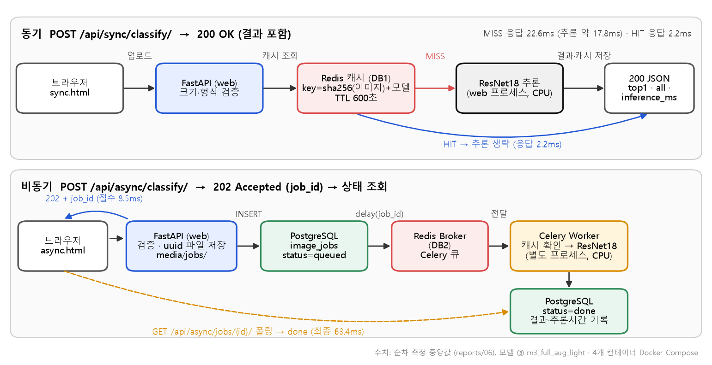

**동기 방식**: 요청을 받은 FastAPI가 결과까지 만들어 한 번에 응답한다.
1. 크기·형식 검증 → 2. Redis 캐시 조회 → 3. HIT면 즉시 응답, MISS면 ResNet18 추론 → 4. 결과를 캐시에 저장(600초) → 5. **200 + 결과 JSON**

**비동기 방식**: 접수와 처리를 분리한다.
1. 크기·형식 검증 → 2. 사진을 `media/jobs/<uuid>.bin`으로 저장 → 3. PostgreSQL에 `queued` 기록 → 4. Redis 브로커로 Celery 큐에 등록 → 5. **즉시 202 + job_id 응답** → 6. Worker가 별도 프로세스에서 추론 후 `done` 기록 → 7. 브라우저가 상태를 조회해 결과 확인

**컴포넌트 역할**

| 컴포넌트 | 실행 위치 | 주요 파일 | 역할 |
|---|---|---|---|
| FastAPI (`web`) | Docker | `main.py`, `ai/router_sync.py`, `ai/router_async.py` | 요청 검증·응답, 동기 추론 |
| Celery Worker | Docker | `ai/celery_app.py`, `ai/tasks.py` | 비동기 추론, DB 상태 갱신 |
| ResNet18 | web·worker 각 프로세스 | `ai/hf_model.py`, `artifacts/m3_full_aug_light/` | 추론 (CPU, 프로세스당 1회 로드 후 재사용) |
| Redis | Docker | `ai/cache_service.py`, `ai/celery_app.py` | DB1 캐시 · DB2 브로커 · DB3 결과 |
| PostgreSQL | Docker | `ai/models.py` | `image_jobs` 작업 상태·결과 |
| 학습 | WSL2 호스트 (GPU) | `training/finetune*.py`, `training/evaluate.py` | Fine-tuning·평가 |

**설계 포인트**
- **캐시 키** = `sha256(이미지 바이트)` + `sha256(MODEL_PATH)`. 모델을 바꾸면 키가 달라져 이전 모델의 결과가 섞이지 않는다. 동기·비동기가 같은 캐시(DB1)를 공유해, 동기로 분류한 사진을 비동기로 보내면 Worker도 캐시 HIT로 처리한다.
- **캐시는 필수가 아닌 최적화**로 설계했다. Redis가 꺼져도 동기 API는 캐시 없이 추론해 200을 돌려준다(6절).
- web과 worker는 별개 프로세스라 **모델이 메모리에 두 번** 올라가고, 사진은 `media/jobs/` 공유 폴더로 주고받는다.
- 각 프로세스의 **첫 추론은 모델 로딩 때문에 약 2.1초**(콜드 스타트), 이후는 약 17ms이다.

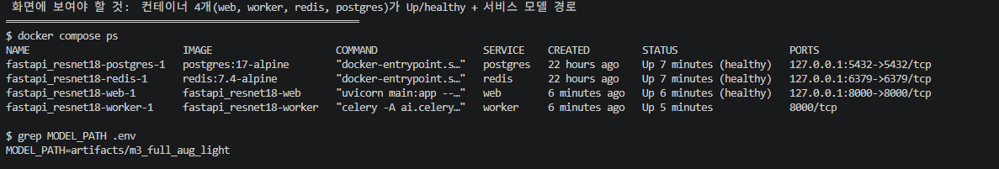

- 근거 문서: [산출물 2](02_시스템_아키텍처.md)

## 4. API·DB 및 버튼 처리

### 4.1 API

| API | Method · URL | 성공 | 실패 | 주요 응답 |
|---|---|---:|---|---|
| 동기 분류 | `POST /api/sync/classify/` | 200 | 400, 413 | `top1`, `all`, `inference_ms`, `cache_hit` |
| 비동기 접수 | `POST /api/async/classify/` | **202** | 400, 413, 503 | `job_id`, `status`, `check_url` |
| 상태 조회 | `GET /api/async/jobs/{job_id}/` | 200 | 404 | `status`, `top1`, `all`, `inference_ms`, `cache_hit`, `error_message` |
| 헬스 체크 | `GET /health` | 200 | — | `status` |
| 화면·문서 | `/vision/sync/`, `/vision/async/`, `/docs` | 200 | — | HTML, Swagger UI |

- 비동기 접수는 "받았지만 아직 끝나지 않았다"는 뜻으로 200이 아닌 **202 Accepted**를 쓴다.

**입력 보호와 오류 코드**

| 상황 | HTTP | 응답 메시지 |
|---|---:|---|
| 이미지가 아닌 파일·잘못된 형식·해상도 초과 | 400 | `올바른 이미지 파일이 아닙니다.` |
| 5MB 초과 | 413 | `5MB 이하 파일만 허용합니다.` |
| 없는 작업 번호 | 404 | `해당 작업이 없습니다.` |
| Redis 큐 등록 실패 (비동기) | 503 | DB에 `failed`와 실패 사유 기록 |

- 업로드 파일명은 사용자가 보낸 이름을 쓰지 않고 **서버가 만든 uuid**로 저장한다.

**동기 응답 예시 (캐시 MISS, 실제 응답)**

```json
{"model_id":"artifacts/m3_full_aug_light",
 "top1":{"label":"bean_rust","score":0.9957},
 "all":[{"label":"bean_rust","score":0.9957},
        {"label":"angular_leaf_spot","score":0.0029},
        {"label":"healthy","score":0.0014}],
 "inference_ms":17.48,"cache_hit":false}
```

같은 사진을 다시 보내면 `"inference_ms":null, "cache_hit":true`가 된다. `null`은 0ms가 아니라 **모델 추론을 생략했다**는 뜻이다.

### 4.2 DB: `image_jobs`

| 컬럼 | 자료형 | 용도 |
|---|---|---|
| `id` | integer, **PK** | 작업 번호 (자동 증가) |
| `image_path` | varchar(150) | `media/jobs/` 안의 uuid 파일명 |
| `status` | varchar(20), 인덱스 | `queued` → `running` → `done` / `failed` |
| `model_id` | varchar(255) | 추론에 사용한 `MODEL_PATH` |
| `top1_label` / `top1_score` / `all_scores` | varchar / double / json | 예측 결과 |
| `inference_ms` / `cache_hit` | double / boolean | 추론시간(HIT면 NULL), 캐시 사용 여부 |
| `error_message` | text | 실패 사유 |
| `created_at` / `updated_at` | timestamptz | 생성·수정 시각 (UTC) |

- 비동기 작업만 기록하고 동기 요청은 기록하지 않는다. 사진 원본은 DB가 아니라 파일로 저장한다.

### 4.3 버튼 처리 화면

| 동기 화면 | 비동기 화면 |
|---|---|
| 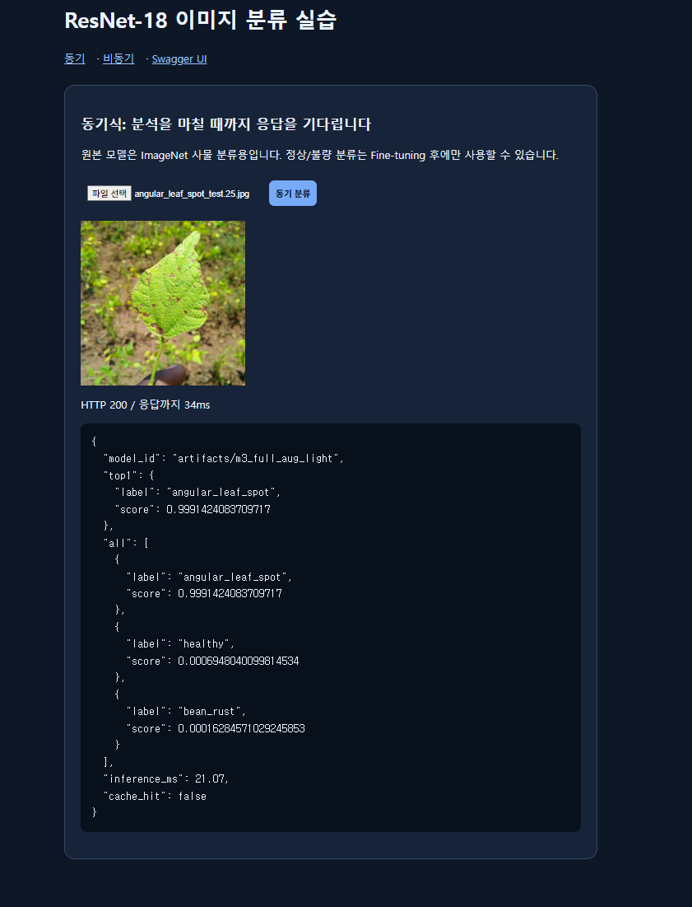 | 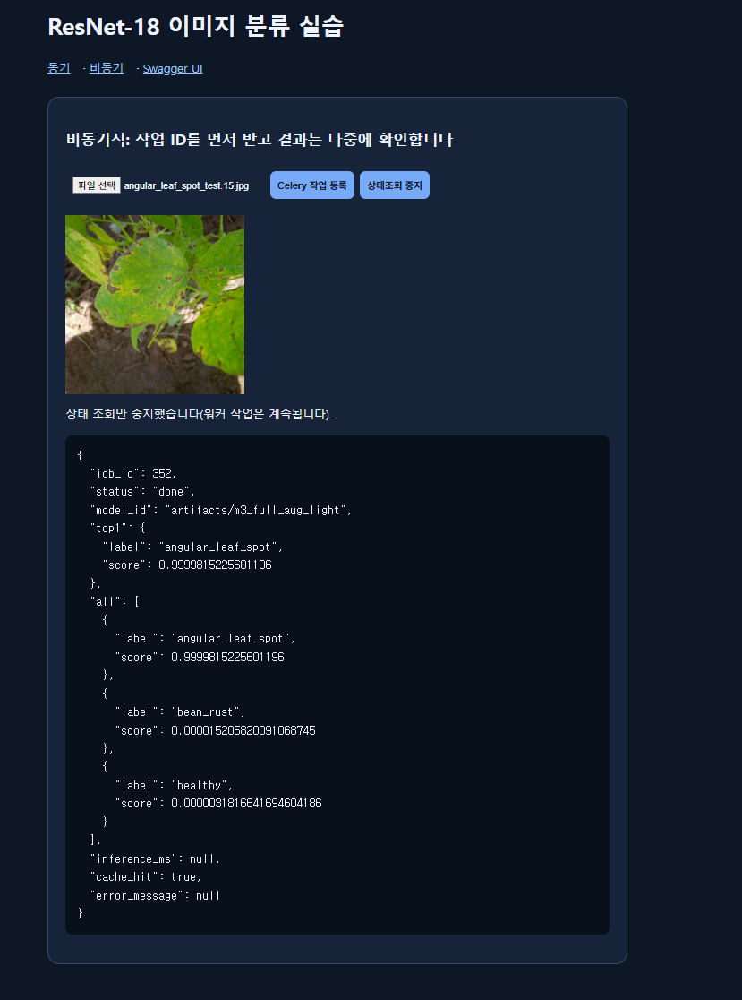 |

**같은 사진 2회 요청: MISS → HIT (추론 생략)**

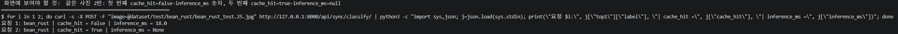

- 근거 문서: [산출물 3](03_API_명세서.md) · [산출물 4](04_DB_구조_작업이력.md) · [산출물 5](05_AI버튼_처리흐름.md)

## 5. 성능 비교

### 5.1 측정 조건

| 조건 | 값 |
|---|---|
| 사진 | Test 사진 5장을 4개 조건(동기·비동기 × 캐시 MISS·HIT)에 똑같이 사용 |
| 모델 | 서비스 모델 ③ `m3_full_aug_light`, 컨테이너 **CPU 추론** |
| 클라이언트 | 같은 PC에서 `127.0.0.1:8000`으로 요청 (네트워크 지연 없음) |
| 반복 | 조건별 5회, 첫 실행(워밍업)은 비교에서 제외 |
| 캐시 MISS / HIT | MISS는 요청 직전 캐시 DB1만 비움, HIT는 MISS 직후 같은 사진 재요청 (응답의 `cache_hit`로 확인) |
| Worker | `solo`, `concurrency=1` |
| 비동기 최종 시간 | 요청 시작 → 상태가 `done`이 될 때까지 (**50ms 간격 폴링 포함**) |

### 5.2 순차 측정 결과 (중앙값)

| 경로 | 캐시 | HTTP 응답 | 결과 확인까지 | 서버 추론시간 |
|---|---|---:|---:|---:|
| 동기 | MISS | 22.6 ms | 22.6 ms | 17.8 ms |
| 동기 | HIT | **2.2 ms** | 2.2 ms | NULL (생략) |
| 비동기 | MISS | **8.5 ms** (접수) | 63.4 ms | 17.6 ms |
| 비동기 | HIT | 7.1 ms (접수) | 65.7 ms | NULL (생략) |

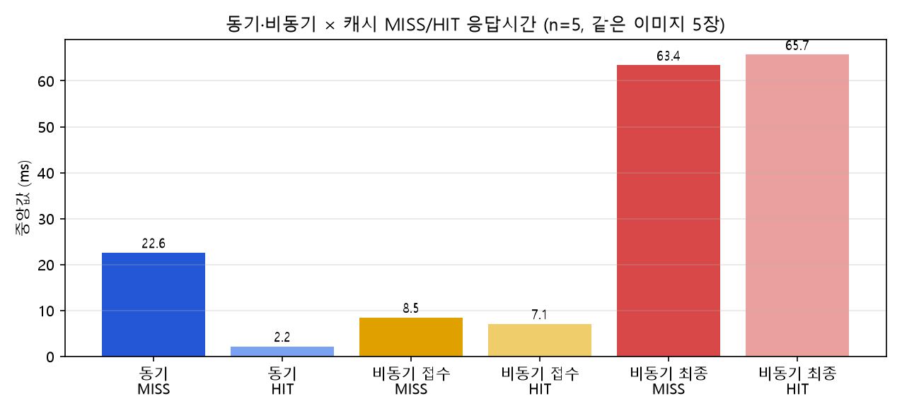

| 지표 | 계산 | 결과 |
|---|---|---:|
| 비동기 접수 응답 단축률 | (22.6 − 8.5) / 22.6 | **62.4 %** 빠름 |
| 결과 확인까지 시간 차이 | 63.4 − 22.6 | 비동기가 **40.8 ms** 느림 |
| 동기 캐시 효과 | (22.6 − 2.2) / 22.6 | **90.3 %** 단축 |
| 콜드 스타트 | 첫 추론 약 2,100 ms ÷ 평소 17.8 ms | 약 **120배** 느림 |

### 5.3 동시 20건 요청

| 조건 | 구분 | 요청별 응답 중앙값 / 최대 | 전체 접수 | 전체 완료 |
|---|---|---|---:|---:|
| MISS | 동기 | 255.6 / 275.2 ms | – | **284.9 ms** |
| MISS | 비동기 | 접수 247.9 / 373.9 ms | 383.2 ms | **743.9 ms** |
| HIT | 동기 | 17.5 / 28.6 ms | – | **31.1 ms** |
| HIT | 비동기 | 접수 98.6 / 109.3 ms | 113.5 ms | **212.5 ms** |

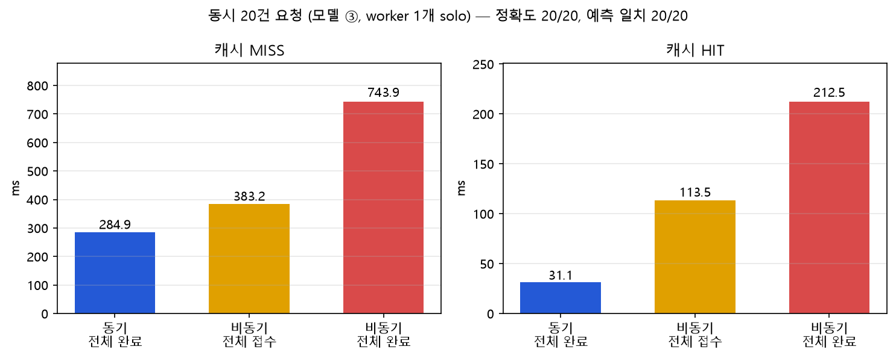

### 5.4 해석

1. **정확도는 방식과 무관했다.** 순차·동시 모두 동기와 비동기의 예측 라벨이 100% 같았다. 같은 모델이 같은 사진을 처리하기 때문이다.
2. **비동기 접수는 62.4% 빨랐지만 결과는 40.8ms 늦었다.** 모델이 빨라진 것이 아니라 접수와 처리를 분리한 효과이다.
3. 이 모델은 추론이 약 17ms로 매우 빨라서, **큐를 거치는 시간과 폴링 간격(50ms)이 추론시간보다 크다.** 그래서 비동기의 이점이 드러나지 않았다.
4. 동시 20건에서도 비동기 접수가 동기 응답보다 빠르지 않았다(247.9 vs 255.6ms). 접수 단계에서도 검증·파일 저장·DB 기록·큐 등록을 하기 때문이다. Worker가 1개라 처리도 순서대로 진행되어 전체 완료가 늦었다.
5. 동시 20건에서 동기 추론시간은 약 17ms → 193ms로 늘었다. 20건이 한 프로세스의 CPU를 나눠 쓰기 때문이다.
6. **비동기가 의미 있는 상황**은 추론이 수 초 이상 걸리거나, 요청을 받은 서버가 결과를 기다리지 않고 다른 일을 해야 할 때이다. 또 Worker가 멈춰도 작업이 큐와 DB에 남아 **유실되지 않는다**(6절). 이번 측정은 그 상황이 아니다.
7. 비동기 최종 시간이 캐시와 거의 무관한 것(63.4 vs 65.7ms)은 측정 해상도가 폴링 간격에 묶였기 때문이다. "캐시가 비동기를 빠르게 하지 않는다"고 결론 내리지 않는다.

- 근거 문서: [산출물 6](06_성능비교_보고서.md) · 원본: [data/timings.csv](data/timings.csv), [data/burst_compare.json](data/burst_compare.json)

## 6. 기능 테스트·오류 조치

### 6.1 시험 결과: 23건 모두 PASS

실환경 통합 시험 21건(실제 모델·Redis·PostgreSQL·Celery·Docker 네트워크) + 모의 테스트 2건(가짜 모델·Redis·SQLite)이다. 모의 테스트가 통과해도 실환경 PASS로 간주하지 않았다.

| 구분 | 시험 ID | 확인 내용 | 결과 |
|---|---|---|---|
| 정상 동작 | T-01 ~ T-06 | health 200, 동기 3클래스 정답, 비동기 202 → `done`, Redis PONG, DB 기록 | PASS |
| 입력 오류 | T-07, T-08, T-10 | `.txt` → 400, 없는 작업 → 404, 5MB+1바이트 → 413 | PASS |
| 캐시 | T-09 | 같은 파일 2회: `cache_hit` false → true, `inference_ms` 18.5 → null | PASS |
| Worker 장애 | T-11, T-11b | Worker 정지 → 접수 202, `queued` 유지 → 재시작 후 `done` | PASS |
| Redis 장애 | T-12 ~ T-14 | 비동기 503 + DB `failed` / 동기는 캐시 없이 200 / 복구 후 정상 | PASS |
| 화면·정적 파일 | T-15a ~ d | `/vision/sync/`, `/vision/async/`, `/docs`, `/static/style.css` 200 | PASS |
| 모의 테스트 | T-16, T-17 | `pytest` 4 passed (로컬·컨테이너) | PASS |

| Worker 정지: 작업이 `queued`로 유지 | Worker 재시작 후 `done` |
|---|---|
| 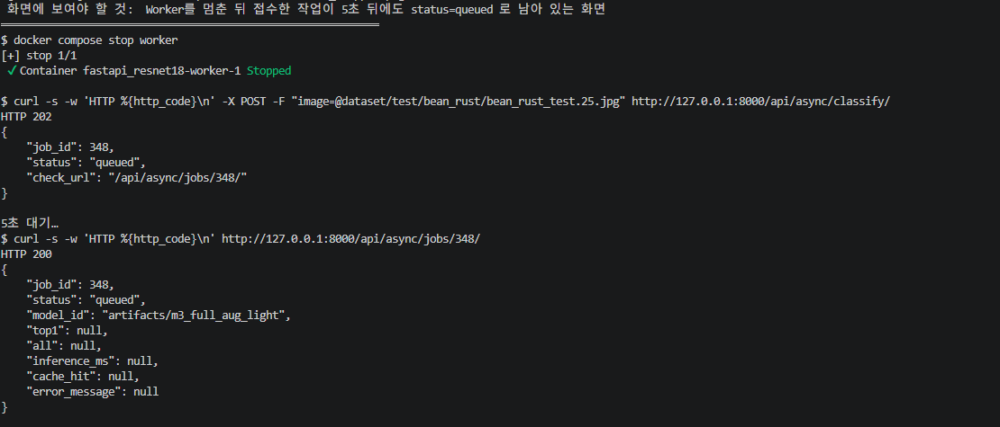 | 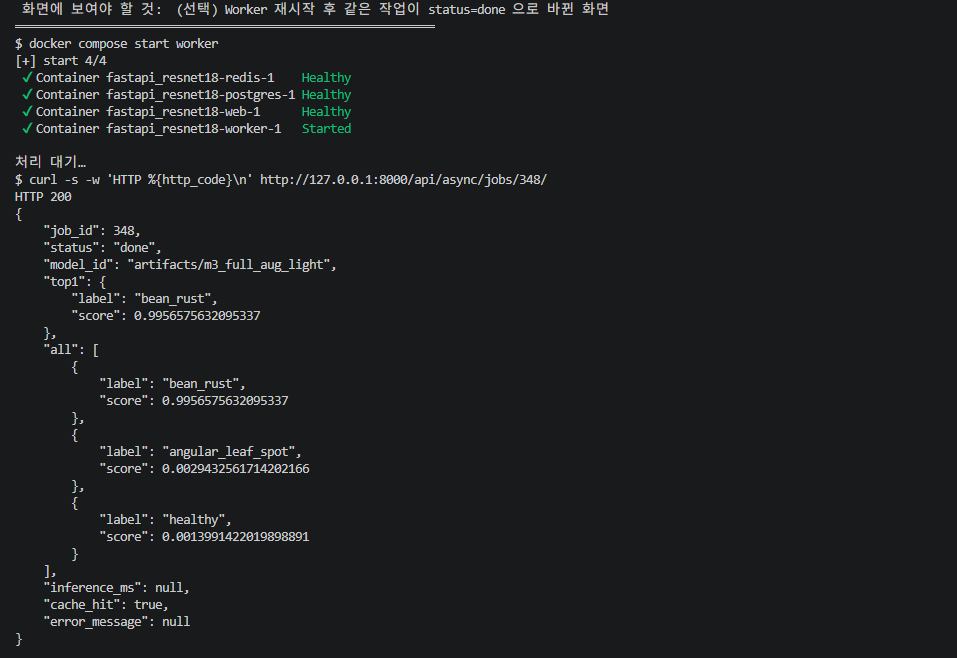 |

- 서비스를 **일부러 멈춰 본 시험**에서, Worker가 꺼져도 작업은 유실되지 않았고 Redis가 꺼져도 동기 API는 정상 응답했다.

### 6.2 개발 중 실제로 겪은 오류

| ID | 현상 | 원인 | 조치 |
|---|---|---|---|
| E-01 | `python3.11: command not found` | Ubuntu에 3.11 미설치 | `uv`로 3.11 환경 생성 |
| E-02 | `No module named pip` | `uv` 가상환경에는 pip 없음 | `python3.11 -m venv`로 재생성 |
| E-03 | `Could not open requirements file` | 파일 생성 전에 설치 실행 | 파일 생성 후 설치 |
| E-04 | `dataset/val` 없음 | 제공 폴더명이 `validation` | 폴더명을 `val`로 변경 |
| E-05 | `docker could not be found` | Docker Desktop 꺼짐 | 실행 후 대기 |
| E-06 | 컨테이너 `pytest`에서 `No module named 'ai'` | 루트가 import 경로에 없음 | `pytest.ini`(`pythonpath = .`) 추가 |
| E-07 | `./run.sh: No such file or directory` | 홈 폴더에서 실행 | 프로젝트 폴더로 이동 후 실행 |
| E-08 | `address already in use` (8200) | 이전 콘솔이 포트 점유 | `--port 8201` 사용, 옛 콘솔 종료 |

### 6.3 관찰 사항과 미실시 시나리오

| 구분 | 내용 |
|---|---|
| O-01 개선 필요 | Redis가 꺼진 상태에서 비동기 접수가 503을 돌려주기까지 **20.1초** 걸렸다. 브로커 연결 재시도 설정 조정이 필요하며, **이번에는 수정하지 않았다.** |
| O-02 의도대로 | Redis가 꺼져도 동기 API는 200 (캐시 폴백) |
| O-03 콜드 스타트 | 모델 전환·Worker 재시작 뒤 첫 추론 약 2.1초 |
| O-04 | 추론이 폴링 간격보다 짧아 `running` 상태는 직접 관찰하지 못했다 |
| 미실시 | 실환경 Worker 내부 예외(모의 테스트로만 검증), PostgreSQL 중지, 20건 초과 부하, 손상된 이미지 파일 |

- 근거 문서: [산출물 7](07_기능테스트_오류분석.md)

## 7. 동기·비동기 비교 콘솔 (`demo.py`)

실제 서비스의 동기·비동기 API에 같은 사진을 같은 조건으로 보내 결과를 나란히 보여주는 단일 파일 GUI이다. 서비스의 일부가 아니라 **측정·확인용 도구**이며, 5.3절의 동시 20건 실험을 이 콘솔로 측정했다.

| 단계 | 하는 일 |
|---|---|
| 1 모델 선택 | 카드 `BASE → ① → ② → ③ → ④`에서 고르면 서비스 모델을 전환한다(web·worker 재시작, 약 30초). 카드에 BASE 대비 변경점이 표시된다 |
| 2 사진 고르기 | 내 사진 업로드(여러 장, 정답 지정) 또는 test 사진 선택. 안 고르면 클래스 균형 무작위 |
| 3 설정·실행 | 캐시 조건(MISS / HIT / 둘 다), 실험 방식(순차 / 동시) |
| 4 결과 | 정확도·응답시간·결과 수신 시간·추론시간·캐시 HIT 수를 동기·비동기 나란히 + 자동 해석 + 사진별 표 |

- `127.0.0.1`에만 바인딩되며 인증은 없다. 실행은 `./run.sh` (사용법은 [README](../README.md) 5절).

## 8. OpenCV 성능 개선 제안 (**설계만, 미구현**)

> 이 절의 내용은 구현하거나 측정하지 않았다. 개선 수치를 주장하지 않는다.

| 제안 | 내용 | 목적 |
|---|---|---|
| 1 | HSV 색공간 병반 후보 마스크 → 병반/잎 면적비 계산 | CNN을 보조할 해석 가능한 특징 |
| 2 | CNN 확신도(top1 score)가 낮고 면적비와 충돌하면 `확인 필요`로 분기 | 불확실 사례를 사람이 재검토 |
| 3 | CNN 점수 + OpenCV 특징(면적비, Contour 수)으로 보조 분류기(Logistic Regression 등) | 융합 분류 |
| 4 | Grad-CAM으로 CNN 주목 영역 시각화 | 오분류 원인 분석 (성능 향상 수단은 아님) |

```text
입력 이미지 ─┬─▶ ResNet18 ─────────────────────────▶ top1.label, score ─┐
             └─▶ RGB→HSV ▶ 잎 마스크 ▶ 병반 후보 마스크 ▶ 면적비 ─────┴─▶ 유지 / 확인 필요
```

**설계 절차 (HSV 병반 후보 분석)**
1. RGB → HSV 변환 후 잎 후보 마스크 생성 (실제 샘플로 임계값 설정)
2. 잎 마스크 안에서 황색·갈색 병반 후보 마스크 생성, Opening/Closing으로 노이즈 정리
3. `ratio = 병반 후보 픽셀 수 / 잎 픽셀 수`를 CNN의 `top1.label`, `top1.score`와 함께 기록
4. Train으로 기준 개발 → Validation으로 임계값 비교 → **Test는 확정 후 1회만** 사용

**규칙 판단표 (가상 임계값, 검증되지 않음)**

| 조건 | AI 예측 | OpenCV 관찰 | 제안 | 근거 |
|---|---|---|---|---|
| A | healthy, score 높음 | 병반 면적비 낮음 | AI 결과 유지 | 두 근거가 일치 |
| B | healthy, score 낮음 | 병반 면적비 높음 | 확인 필요 | 낮은 신뢰도 + 병반 후보 |
| C | bean_rust, score 높음 | 병반 면적비 높음 | AI 결과 유지 + 시각화 | 일관됨 (병명 단정은 불가) |

- HSV 마스크는 병명을 확정하는 진단 근거가 아니다. 서비스 모델의 오분류가 128장 중 5장뿐이라 규칙 보조의 개선 여지는 작고 오탐 위험이 있을 수 있다(실험이 아닌 추정).

## 9. 최종 판정 및 한계

**필수 기능 판정**

| 필수 항목 | 판정 | 근거 |
|---|---|---|
| 콩잎 3클래스 데이터 구조 확인 | 완료 | 산출물 1 (1,295장, 중복 0건) |
| Head-only ResNet18 학습·모델 저장·동기 API | 완료 | 산출물 1, 7 |
| Redis·PostgreSQL·Celery·비동기 접수·상태 조회 | 완료 | 산출물 4, 5, 7 |
| 캐시 HIT/MISS, DB 작업 기록, 응답시간 비교 | 완료 | 산출물 4, 6 |
| 8개 산출물 + README | 작성 완료 | `reports/01~08`, `README.md` |
| 선택: Full Fine-tuning 비교 | **수행** | 산출물 1 (②) |
| 선택: 데이터 증강 비교 | **수행** (3종×3시드, 경향 관찰) | 산출물 1의 6절 |
| 선택: OpenCV·ML 융합 | 설계 제안만 | 본 문서 8절 |

**한계**
- Test 128장이라 한 장당 0.78%p이며, ②③④의 차이는 구분할 수 없다.
- 학습은 모델당 1회(시드 42)이다. 증강 3종만 시드 3개로 반복해 변동(Test 표준편차 약 0.5~0.8%p)을 측정했고, 같은 시드로 다시 학습해도 최대 2장 흔들렸다.
- 같은 잎을 다른 각도로 찍은 유사 사진이 split에 걸쳐 있는지 점검하지 못했다.
- 현장 조명·배경이 다른 사진, 데이터셋 밖 이미지의 성능은 측정하지 않았다.
- 성능 비교는 사진 5장×5회, 동시 20건 1회이며 더 높은 부하는 측정하지 않았다. 추론은 CPU 기준이며 GPU 추론은 미측정이다.
- 실행 화면 캡처는 별도 회차에서 찍어 작업 번호·추론시간이 본문과 다를 수 있다.
- 인증이 없는 학습용 로컬 서비스이다.

**추후 과제**

| 과제 | 이유 |
|---|---|
| 새 데이터(학습·선택에 쓰지 않은 사진)로 증강 효과 재확인 | 이번 증강 비교는 Test를 사용해 낙관적 |
| 추론이 느린 모델이나 일괄 처리 조건에서 동기·비동기 재비교 | 이번 모델은 추론 17ms로 비동기 이점이 드러나지 않음 |
| Redis 장애 시 비동기 503 응답 지연(20초) 개선 | 브로커 연결 재시도·타임아웃 설정 조정 필요 |
| OpenCV 규칙 검증 구현과 Validation 기준 평가 | 8절은 설계만 완료 |

## 10. 산출물 목차

| 번호 | 문서 | 핵심 내용 |
|---|---|---|
| 1 | [01_FineTuning_결과보고서](01_FineTuning_결과보고서.md) | 데이터·학습·Test 평가·모델 선택·증강 실험 |
| 2 | [02_시스템_아키텍처](02_시스템_아키텍처.md) | 구성도·환경 |
| 3 | [03_API_명세서](03_API_명세서.md) | 요청·응답·상태코드 |
| 4 | [04_DB_구조_작업이력](04_DB_구조_작업이력.md) | 테이블·작업 이력 |
| 5 | [05_AI버튼_처리흐름](05_AI버튼_처리흐름.md) | 시퀀스·코드 대응 |
| 6 | [06_성능비교_보고서](06_성능비교_보고서.md) | 측정·비교·동시 실험·해석 |
| 7 | [07_기능테스트_오류분석](07_기능테스트_오류분석.md) | 23건 시험·오류 이력 |
| 8 | 본 문서 + [README](../README.md) | 종합·재현 안내 |
