# 콩잎 질병 분류 Vision AI API 서비스 기술보고서

## 0. 한눈에 보는 결과

| 항목 | 결과 | 근거 |
|---|---|---|
| 서비스 모델 | ③ `m3_full_aug_light` (Validation 최고 점수로 선택) | 산출물 1 |
| Test 정확도 (128장) | ① 0.7188 → ② 0.9688 (**+25.0%p**) · 서비스 모델 ③ 0.9609 | 2절 |
| 동기 응답 (캐시 MISS / HIT) | 22.6 ms / **2.2 ms** (캐시로 90.3% 단축) | 6절 |
| 비동기 접수 / 최종 확인 | **8.5 ms** / 63.4 ms (접수는 빠르지만 결과는 40.8 ms 늦음) | 6절 |
| 동기·비동기 정확도 | 같음 (예측 라벨 일치 100%) | 6절 |
| 기능 시험 | **23건 / 23건 PASS** (장애 시험 포함) | 7절 |
| 실행 구조 | Docker Compose 4개 컨테이너 (web · worker · redis · postgres) | 3절 |

## 1. 프로젝트 정보

- 프로젝트: ResNet18 기반 콩잎 3클래스 분류 및 동기·비동기 서빙
- 입력: JPG/PNG/WEBP (5MB 이하, 1,200만 픽셀 이하) · 출력: `angular_leaf_spot` / `bean_rust` / `healthy`
- 모델: `microsoft/resnet-18` → Fine-tuning 4종(`m1`~`m4`), **서비스 모델 `m3_full_aug_light`**
- 실행 구조: **FastAPI·Celery·Redis·PostgreSQL 모두 Docker Compose 4개 컨테이너**, 모델 학습은 WSL2 호스트(GPU)
- 작성 기준: 이 보고서의 모든 수치는 실제 실행 결과이며 근거 파일 경로를 함께 적었다. 측정하지 않은 항목은 "미측정"으로 표기했다.
- 재현 방법은 프로젝트 루트의 [README](../README.md)를 따른다.

**기술 스택 및 실행 환경** (원본: [evidence/environment.txt](evidence/environment.txt))

| 구분 | 내용 |
|---|---|
| 모델 | `microsoft/resnet-18` (ImageNet 사전학습) → 출력층 1,000 → 3클래스 교체 |
| 학습 | WSL2 Ubuntu 호스트 `.venv`, Python 3.11.17, torch 2.15.0+cu132, **RTX 3060 12GB (GPU)** |
| 서빙 | FastAPI 0.162.0 + Celery 5.6.3 (컨테이너, Python 3.11.18, **torch 2.5.1+cpu**) |
| 캐시·브로커 | Redis 7.4 (DB1 캐시 · DB2 브로커 · DB3 결과) |
| DB | PostgreSQL 17 (`image_jobs`) |
| 하드웨어 | Intel Core i7-12700, WSL 메모리 15GiB |

## 2. 모델 학습 결과 요약

**데이터 구성** (총 1,295장, SHA-256 비교로 중복 0건 · split 간 중복 0건)

| 클래스 | Train | Validation | Test |
|---|---:|---:|---:|
| angular_leaf_spot | 345 | 44 | 43 |
| bean_rust | 348 | 45 | 43 |
| healthy | 341 | 44 | 42 |
| **합계** | **1,034** | **133** | **128** |

- Train으로 학습, Validation으로 모델 선택, **Test는 학습·선택에 쓰지 않고 마지막 평가에만** 사용했다.

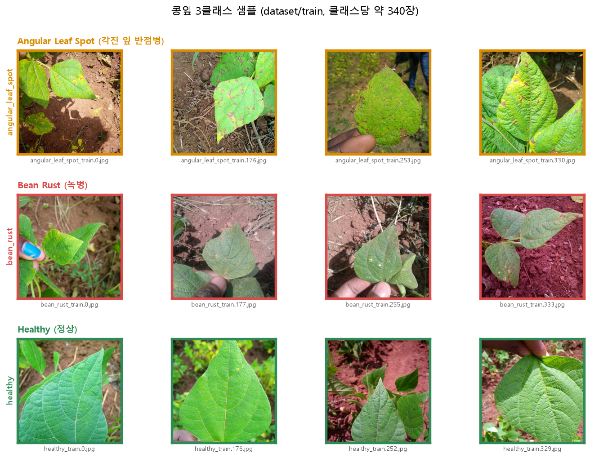

- 현장에서 손으로 잎을 들고 찍은 사진이 많고, 배경(흙·풀)과 조명이 제각각이다. `angular_leaf_spot`과 `bean_rust`는 둘 다 잎에 갈색·황색 반점이 생겨 눈으로도 구분이 어렵다.

**모델 4종 학습 설정**

| 모델 | 학습 방식 | 에폭 | 배치 | lr | 증강 | 저장 시점 |
|---|---|---:|---:|---|---|---|
| ① `m1_head_only` | Head-only (Backbone 고정) | 3 | 8 | 2e-4 | 없음 | 2에폭 |
| ② `m2_full` | Full (전체 가중치) | 10 | 16 | 1e-4 | 없음 | 4에폭 |
| ③ `m3_full_aug_light` | Full | 10 | 16 | 1e-4 | light (뒤집기·회전 ±15°·밝기/대비 ±15%) | 8에폭 |
| ④ `m4_full_aug_medium` | Full | 10 | 16 | 1e-4 | medium (확대 70~100%·회전 ±30°·밝기/대비 ±25%·채도 ±10%) | 5에폭 |

- 학습 코드는 **Validation 정확도가 최고인 에폭의 가중치만 저장**한다. 시드는 모두 42.


| 학습 기록 (`training_report.json`, ①) | 저장된 모델 폴더 (①·③) |
|---|---|
| 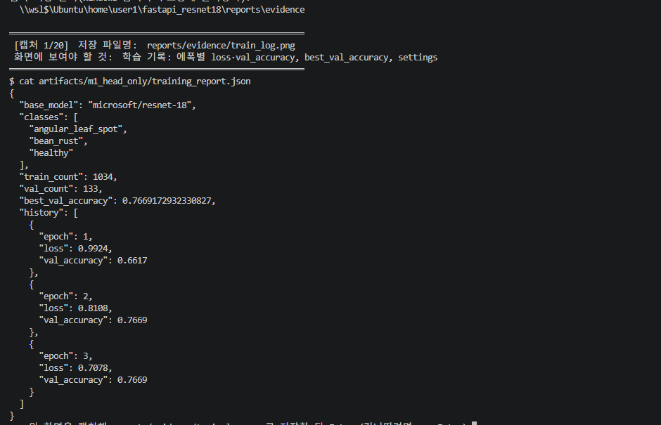 | 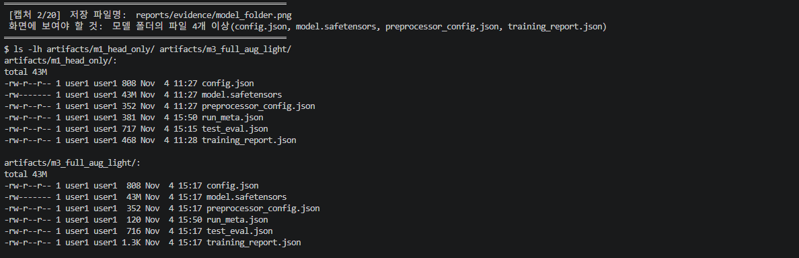 |

- 모델 폴더마다 `config.json`, `model.safetensors`(약 43MB), `preprocessor_config.json`, `training_report.json`, `test_eval.json`, `run_meta.json`이 저장된다.

**결과**

| 모델 | BASE에서 더해진 것 | Best Val | Test Accuracy (128장) |
|---|---|---:|---:|
| ① `m1_head_only` | 출력층 교체 + 분류 헤드만 학습 (3ep) | 0.7669 | 0.7188 (92/128) |
| ② `m2_full` | ① + 전체 가중치 학습 (10ep, lr 1e-4) | 0.9925 | 0.9688 (124/128) |
| **③ `m3_full_aug_light` (서비스)** | ② + 증강 light | **1.0000** | 0.9609 (123/128) |
| ④ `m4_full_aug_medium` | ② + 증강 medium | 0.9850 | 0.9688 (124/128) |


- **서비스 모델은 Validation 최고 점수로 선택**했다(③). Test로 모델을 고르지 않았다. 다만 ②③④의 차이는 Val 최대 2장, Test 1장이라 **사실상 동률**이다.
- Test Accuracy 변화: ① 0.7188 → ② 0.9688 = **25.0%p 상승**. 가장 큰 개선은 `bean_rust` 재현율(0.535 → 0.954)이다.
- Test 평가는 이 작업에서 추가한 `training/evaluate.py`로 측정했다(제공 코드에는 없음).

**클래스별 Precision / Recall / F1 (Test)**

| 클래스 | ① P / R / F1 | ② P / R / F1 | ③ P / R / F1 (서비스) | ④ P / R / F1 |
|---|---|---|---|---|
| angular_leaf_spot | 0.698 / 0.698 / 0.698 | 0.956 / 1.000 / 0.977 | 0.954 / 0.954 / 0.954 | 0.954 / 0.954 / 0.954 |
| bean_rust | 0.697 / **0.535** / 0.605 | 0.954 / 0.954 / 0.954 | 0.932 / 0.954 / 0.943 | 0.954 / 0.954 / 0.954 |
| healthy | 0.750 / 0.929 / 0.830 | 1.000 / 0.952 / 0.976 | 1.000 / 0.976 / 0.988 | 1.000 / 1.000 / 1.000 |


- 남은 오답은 대부분 `angular_leaf_spot` ↔ `bean_rust` 간 혼동이다. 서비스 모델 ③의 오분류는 128장 중 5장이다.

**서비스 모델 ③의 오분류 사진 5장**

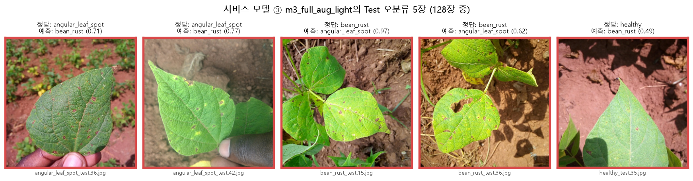

| 파일 | 정답 | 예측 | 예측 확률 |
|---|---|---|---:|
| `angular_leaf_spot_test.36.jpg` | angular_leaf_spot | bean_rust | 0.71 |
| `angular_leaf_spot_test.42.jpg` | angular_leaf_spot | bean_rust | 0.77 |
| `bean_rust_test.15.jpg` | bean_rust | angular_leaf_spot | 0.97 |
| `bean_rust_test.36.jpg` | bean_rust | angular_leaf_spot | 0.62 |
| `healthy_test.35.jpg` | healthy | bean_rust | 0.49 |

- 오분류 목록은 호스트 `.venv`에서 ③ 모델로 test 128장을 다시 추론해 얻었다(정답 123/128, 혼동행렬과 일치). 원본: [data/misclassified_m3.json](data/misclassified_m3.json)
- 5장 중 4장은 예측 확률이 0.8 미만이었다. 확률이 낮은 결과를 "확인 필요"로 돌리는 방안(9절 제안 2)의 근거가 될 수 있으나, 정답 사진의 확률 분포는 확인하지 않았으므로 **임계값 효과는 측정하지 않았다.** `bean_rust_test.15`는 0.97로 확신하며 틀렸다.

**데이터 증강 반복 실험 (3종 × 시드 3개 = 9회)**

| 증강 | Val 평균 ± 표준편차 | Test 평균 ± 표준편차 | Test 범위 |
|---|---|---|---|
| none | 0.9900 ± 0.0043 | 0.9453 ± 0.0078 | 0.9375 ~ 0.9531 |
| light | 0.9950 ± 0.0043 | 0.9583 ± 0.0045 | 0.9531 ~ 0.9609 |
| medium | 0.9925 ± 0.0075 | 0.9792 ± 0.0045 | 0.9766 ~ 0.9844 |


- 증강 반복 실험(3종×3시드): Validation은 포화되어 구분되지 않았고, Test 평균은 none 0.945 → light 0.958 → medium 0.979로 올랐다. **이 비교에 Test를 사용했으므로 낙관적**이며 "증강이 개선했다"고 단정하지 않는다.
- 근거 문서: [산출물 1](01_FineTuning_결과보고서.md) · 원본: [data/](data/)

## 3. 아키텍처 및 데이터 흐름


- 동기: 브라우저 → FastAPI → Redis Cache → (MISS) ResNet18 → JSON
- 비동기: 브라우저 → FastAPI → PostgreSQL `queued` → Redis Broker → Celery Worker → ResNet18 → PostgreSQL `done` → 상태 조회
- web과 worker는 별개 컨테이너이며 각 프로세스가 모델을 따로 메모리에 올린다. 추론은 컨테이너에서 CPU로 수행한다.
- 캐시 키는 `sha256(이미지 바이트)` + `sha256(MODEL_PATH)`로 만들어, 모델을 바꾸면 이전 결과가 섞이지 않는다(TTL 600초). 동기·비동기가 같은 캐시(DB1)를 공유한다.

**컴포넌트 역할**

| 컴포넌트 | 실행 위치 | 주요 파일 | 역할 |
|---|---|---|---|
| FastAPI (`web`) | Docker | `main.py`, `ai/router_sync.py`, `ai/router_async.py` | 요청 검증·응답, 동기 추론 |
| Celery Worker | Docker | `ai/celery_app.py`, `ai/tasks.py` | 비동기 추론, DB 상태 갱신 |
| ResNet18 | web·worker 각 프로세스 | `ai/hf_model.py`, `artifacts/m3_full_aug_light/` | 추론 (CPU, 프로세스당 1회 로드) |
| Redis | Docker | `ai/cache_service.py` | DB1 캐시 · DB2 브로커 · DB3 결과 |
| PostgreSQL | Docker | `ai/models.py` | `image_jobs` 작업 상태·결과 |
| 학습 | WSL2 호스트 (GPU) | `training/finetune*.py`, `training/evaluate.py` | Fine-tuning·평가 |
| 비교 콘솔 | WSL2 호스트 | `demo.py` | 동기·비동기 비교용 도구 (서비스 아님) |

**컨테이너 4개 실행 상태 (서비스 모델 `m3_full_aug_light`)**


**Redis·PostgreSQL 연결 확인 (T-05)**

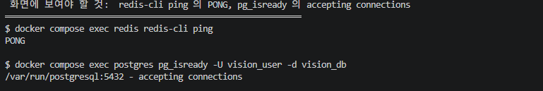

**Celery Worker 로그: 작업 수신 → 완료**

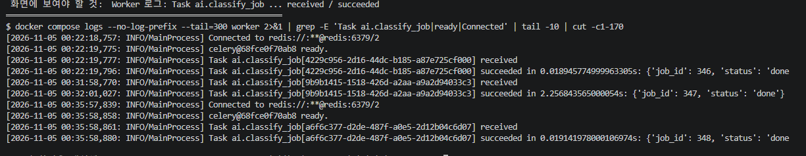

- 작업 347은 Worker 재시작 직후의 첫 추론이라 2.26초(콜드 스타트), 346·348은 약 0.02초에 끝났다.

- 근거 문서: [산출물 2](02_시스템_아키텍처.md)

## 4. API·DB 설계

| API | Method · URL | 성공 | 실패 | 주요 응답 |
|---|---|---:|---|---|
| 동기 분류 | `POST /api/sync/classify/` | 200 | 400, 413 | `top1`, `all`, `inference_ms`, `cache_hit` |
| 비동기 접수 | `POST /api/async/classify/` | **202** | 400, 413, 503 | `job_id`, `status`, `check_url` |
| 상태 조회 | `GET /api/async/jobs/{job_id}/` | 200 | 404 | `status`, `top1`, `all`, `inference_ms`, `cache_hit`, `error_message` |
| 헬스 체크 | `GET /health` | 200 | — | `status` |
| 화면 | `GET /vision/sync/`, `/vision/async/`, `/docs` | 200 | — | HTML, Swagger UI |

**Swagger UI (`/docs`)에서 동기 분류 실행**

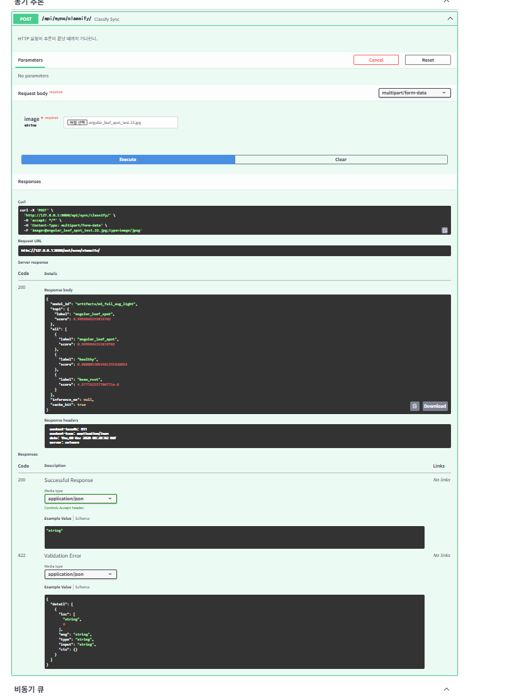

**입력 보호와 오류 코드**

| 상황 | HTTP | 응답 |
|---|---:|---|
| 이미지가 아닌 파일 (`.txt` 등)·형식·해상도 오류 | 400 | `올바른 이미지 파일이 아닙니다.` |
| 5MB 초과 | 413 | `5MB 이하 파일만 허용합니다.` |
| 없는 작업 번호 | 404 | `해당 작업이 없습니다.` |
| Redis 큐 등록 실패 (비동기) | 503 | DB에 `failed` 기록 |

| 이미지가 아닌 파일 → 400 (T-07) | 없는 작업 번호 → 404 (T-08) |
|---|---|
| 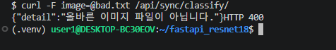 | 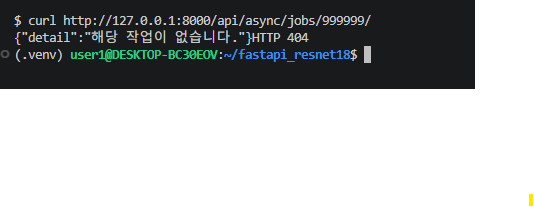 |

- 핵심 API: 동기 분류(200), 비동기 접수(202), 상태 조회(200/404), health
- 입력 보호: 5MB 제한(413), 형식·해상도 검증(400), 서버가 만든 uuid 파일명, 큐 등록 실패 시 503

**동기 응답 예시 (캐시 MISS, 실제 응답)**

```json
{"model_id":"artifacts/m3_full_aug_light",
 "top1":{"label":"bean_rust","score":0.9957},
 "all":[{"label":"bean_rust","score":0.9957},
        {"label":"angular_leaf_spot","score":0.0029},
        {"label":"healthy","score":0.0014}],
 "inference_ms":17.48,"cache_hit":false}
```

같은 사진을 다시 보내면 `"inference_ms":null,"cache_hit":true` (모델 추론 생략).

**실제 호출 화면 (같은 사진 `bean_rust_test.25.jpg`)**

동기 분류 → HTTP 200 (T-02)

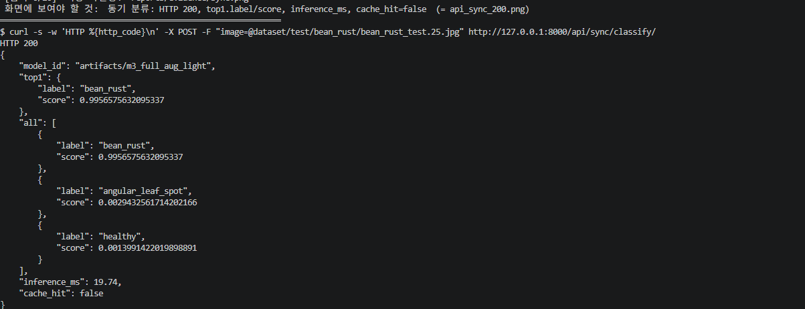

비동기 접수 → HTTP 202 + `job_id` (T-03)

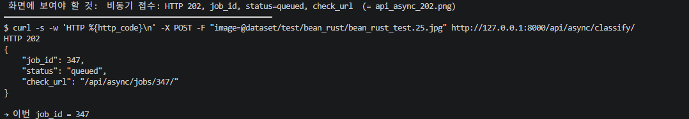

상태 조회 → `done` (T-04)

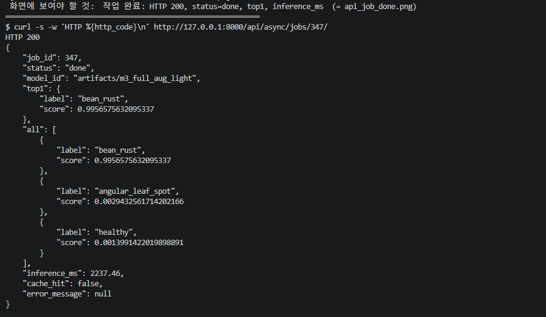

- 캡처의 작업 347은 서비스 재시작 직후 첫 추론이라 `inference_ms`가 2,237ms이다(콜드 스타트). 평소 추론은 약 17ms이다.

**DB: `image_jobs` 테이블 (PostgreSQL 17)**

| 컬럼 | 자료형 | 용도 |
|---|---|---|
| `id` | integer, **PK** | 작업 번호 (자동 증가) |
| `image_path` | varchar(150) | `media/jobs/` 안의 uuid 파일명 |
| `status` | varchar(20), 인덱스 | `queued` → `running` → `done` / `failed` |
| `model_id` | varchar(255) | 추론에 사용한 `MODEL_PATH` |
| `top1_label` / `top1_score` | varchar / double | 1등 라벨·확률 |
| `all_scores` | json | 전체 순위 `[{label, score}, ...]` |
| `inference_ms` | double | 추론시간 (캐시 HIT면 NULL) |
| `cache_hit` | boolean | 캐시 사용 여부 |
| `error_message` | text | 실패 사유 |
| `created_at` / `updated_at` | timestamptz | 생성·수정 시각 (UTC) |

- DB: PostgreSQL `image_jobs` 1개 테이블, 비동기 작업 추적 (동기 요청은 기록하지 않음). 사진 원본은 DB가 아니라 `media/jobs/<uuid>.bin` 파일로 저장한다.

**실제 스키마 (`\d image_jobs`)**

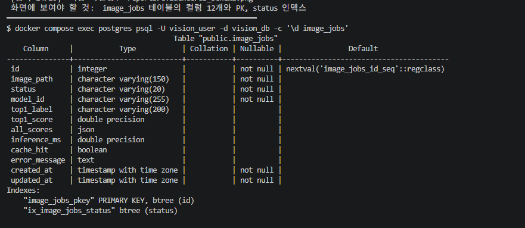

**작업 이력 조회**

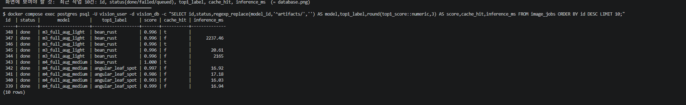

- 근거 문서: [산출물 3](03_API_명세서.md) / [산출물 4](04_DB_구조_작업이력.md)

## 5. 실제 버튼 처리 검증

| 단계 | 동기 (`sync.html`) | 비동기 (`async.html`) |
|---|---|---|
| 1 | 이미지 선택 → `POST /api/sync/classify/` | 이미지 선택 → `POST /api/async/classify/` |
| 2 | 크기·형식 검증 | 크기·형식 검증 → `media/jobs/<uuid>.bin` 저장 |
| 3 | Redis 캐시 조회 (HIT면 즉시 응답) | `image_jobs`에 `queued` INSERT → Celery 큐 등록 |
| 4 | MISS면 ResNet18 추론 → 캐시 저장(600초) | **202 + job_id** 즉시 응답 |
| 5 | **200 + 결과 JSON** | Worker: `running` → 캐시 확인 → 추론 → `done` 기록 |
| 6 | 화면에 라벨·점수 출력 | 브라우저가 1초 간격으로 상태 조회 → `done`이면 결과 출력 |

- 동기식: 추론이 끝난 뒤 200 응답에 결과 포함. 같은 사진 재요청은 Redis HIT로 추론 생략.
- 비동기식: 202/`job_id` 수신 → Worker가 별도 프로세스에서 처리 → 상태 조회로 `done` 확인 → PostgreSQL 행 확인.

| 동기 화면 | 비동기 화면 |
|---|---|
|  |  |

**캐시 동작 확인 (같은 사진 2회: MISS → HIT)**


- 근거 문서: [산출물 5](05_AI버튼_처리흐름.md)

## 6. 실제 성능 비교 (최종 모델, 중앙값)

| 항목 | 순차 (사진 5장×조건별 5회) |
|---|---:|
| 동기 MISS 응답 | 22.6 ms |
| 동기 HIT 응답 | 2.2 ms |
| 비동기 MISS 접수 응답 | 8.5 ms |
| 비동기 MISS 최종 확인 (폴링 50ms 포함) | 63.4 ms |
| 비동기 HIT 최종 확인 | 65.7 ms |
| 서버 추론시간 (MISS) | 약 17.8 ms |
| 첫 추론(콜드 스타트) | 약 2,100 ms |


**계산**

| 지표 | 계산식 | 결과 |
|---|---|---:|
| 비동기 접수 응답 단축률 | (22.6 − 8.5) / 22.6 | **62.4 %** 빠름 |
| 결과 확인까지 시간 차이 | 63.4 − 22.6 | 비동기가 **40.8 ms** 느림 |
| 동기 캐시 효과 | (22.6 − 2.2) / 22.6 | **90.3 %** 단축 |
| 비동기 최종의 캐시 효과 | 65.7 − 63.4 | +2.3 ms (폴링 간격 때문에 구분 불가) |
| 콜드 스타트 배율 | 2,100 / 17.8 | 약 **120배** 느림 |

| 동시 20건 | 동기 전체 완료 | 비동기 전체 접수 | 비동기 전체 완료 |
|---|---:|---:|---:|
| 캐시 MISS | 284.9 ms | 383.2 ms | 743.9 ms |
| 캐시 HIT | 31.1 ms | 113.5 ms | 212.5 ms |


- **정확도는 동기·비동기가 같았다**(예측 라벨 일치 100%).
- 비동기는 순차에서 **접수 응답이 62.4% 빨랐으나 결과 확인까지는 40.8ms 더 걸렸다.** 동시 20건에서도 접수 응답이 동기 응답보다 빠르지 않았고 전체 완료는 더 늦었다. 이 모델은 추론이 약 17ms로 빨라 큐·폴링 오버헤드가 더 컸기 때문이다.
- 캐시 HIT는 동기 응답을 90.3% 단축했다.
- 비동기의 이점은 추론이 오래 걸리거나 처리를 기다리는 동안 web이 다른 일을 해야 하는 상황에서 나타나며, 이번에는 그 상황을 측정하지 않았다. **추론 가속은 확인되지 않았다.**
- 측정 조건: 같은 PC(WSL2, i7-12700)에서 `127.0.0.1:8000`으로 요청, 추론은 컨테이너 CPU, worker `solo`·`concurrency=1`, 워밍업 1회 제외.
- 근거 문서: [산출물 6](06_성능비교_보고서.md) · 원본: [data/timings.csv](data/timings.csv), [data/burst_compare.json](data/burst_compare.json)

## 7. 기능 테스트·오류 조치

- 실환경 통합 시험 21건 + 모의 테스트 2건(로컬·컨테이너) = **23건 모두 PASS**.

| 구분 | 시험 ID | 확인 내용 | 결과 |
|---|---|---|---|
| 정상 동작 | T-01 ~ T-06 | health, 동기 3클래스 정답, 비동기 접수 202 → done, Redis PONG, DB 기록 | PASS |
| 입력 오류 | T-07, T-08, T-10 | `.txt` → 400, 없는 작업 → 404, 5MB+1바이트 → 413 | PASS |
| 캐시 | T-09 | 같은 파일 2회: `cache_hit` false → true, `inference_ms` 18.5 → null | PASS |
| Worker 장애 | T-11, T-11b | Worker 정지 → 202 접수·`queued` 유지 → 재시작 후 `done` | PASS |
| Redis 장애 | T-12 ~ T-14 | 비동기 503 + DB `failed` / 동기는 캐시 없이 200 / 복구 후 정상 | PASS |
| 화면·정적 파일 | T-15a ~ d | `/vision/sync/`, `/vision/async/`, `/docs`, `/static/style.css` 200 | PASS |
| 모의 테스트 | T-16, T-17 | `pytest` 4 passed (로컬·컨테이너) | PASS |

| 헬스 체크 200 (T-01) | 모의 테스트 4 passed (T-16·T-17, 실환경 시험 아님) |
|---|---|
| 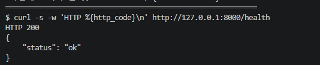 | 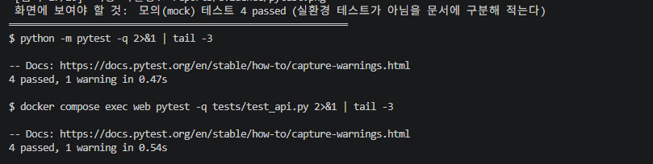 |

- 서비스를 일부러 멈춘 시험: Worker 정지 → `queued` 유지 후 재시작 시 `done`, Redis 정지 → 비동기 503 + DB `failed`, 동기는 캐시 없이 200 유지, 복구 후 정상.

| Worker 정지: 작업이 `queued`로 유지 | Worker 재시작 후 `done` |
|---|---|
|  |  |

**개발 중 실제로 겪은 오류 (E-01 ~ E-08)**

| ID | 현상 | 원인 | 조치 |
|---|---|---|---|
| E-01 | `python3.11: command not found` | Ubuntu에 3.11 미설치 | `uv`로 3.11 환경 생성 |
| E-02 | `No module named pip` | `uv` 가상환경에는 pip 없음 | `python3.11 -m venv`로 재생성 |
| E-03 | `Could not open requirements file` | 파일 생성 전 설치 실행 | 파일 생성 후 설치 |
| E-04 | `dataset/val` 없음 | 제공 폴더명이 `validation` | `mv dataset/validation dataset/val` |
| E-05 | `docker could not be found` | Docker Desktop 꺼짐 | 실행 후 대기 |
| E-06 | 컨테이너 `pytest`에서 `No module named 'ai'` | 루트가 import 경로에 없음 | `pytest.ini`(`pythonpath = .`) 추가 |
| E-07 | `./run.sh: No such file or directory` | 홈 폴더에서 실행 | 프로젝트 폴더로 이동 |
| E-08 | `address already in use` (8200) | 이전 콘솔이 포트 점유 | `--port 8201` 사용·옛 콘솔 종료 |

- 관찰된 개선 필요 사항: Redis 중지 시 비동기 접수가 503을 반환하기까지 **20.1초** 소요(수정하지 않음).
- 근거 문서: [산출물 7](07_기능테스트_오류분석.md)

## 8. 동기·비동기 비교 콘솔 (`demo.py`)

사용자가 고른 사진(업로드 또는 test 사진 선택)을 실제 서비스의 동기·비동기 API에 같은 조건으로 보내 정확도·응답시간·완료시간·캐시 효과를 나란히 보여주는 단일 파일 GUI이다. 서비스의 일부가 아니라 **측정·확인용 도구**이다.

| 단계 | 하는 일 |
|---|---|
| 1 모델 선택 | 카드 `BASE → ① → ② → ③ → ④`에서 고르면 서비스 모델을 전환 (web·worker 재시작, 약 30초) |
| 2 사진 고르기 | 내 사진 업로드(여러 장, 정답 지정) 또는 test 사진 선택. 안 고르면 클래스 균형 무작위 |
| 3 설정·실행 | 캐시 조건(MISS / HIT / 둘 다), 실험 방식(순차 / 동시) |
| 4 결과 | 정확도·응답시간·결과 수신 시간·추론시간·캐시 HIT 수를 동기·비동기 나란히 + 사진별 표 |

- 모델 카드(`BASE → ① → ② → ③ → ④`)에서 모델을 고르면 서비스 모델을 전환하고 비교한다. 카드에 BASE에서 무엇이 더해진 모델인지 표시한다.
- 순차·동시, 캐시 MISS·HIT를 선택할 수 있다. 06 문서의 동시 20건 실험은 이 콘솔로 측정했다.
- 흑백 단순 화면이며 127.0.0.1에만 바인딩된다. 사용법은 [README](../README.md) 5절.

## 9. 교과 9 OpenCV 성능 개선 제안 (**설계 제안만, 미구현**)

> 이 절의 내용은 **구현하거나 측정하지 않았다.** 개선 수치를 주장하지 않는다.

| 번호 | 제안 | 목적 | 구현 여부 |
|---|---|---|---|
| 제안 1 | HSV 색공간 병반 후보 마스크 → 병반/잎 면적비 계산 | CNN 결과를 보조할 해석 가능한 특징 | **미구현** |
| 제안 2 | CNN 확신도(top1 score)가 낮고 병반 면적비와 충돌하면 `확인 필요`로 분기 | 불확실 사례를 사람이 재검토 | **미구현** |
| 제안 3 | CNN 점수 + OpenCV 특징(면적비, Contour 수)을 입력으로 보조 분류기(Logistic Regression 등) | 융합 분류 | **미구현** |
| 제안 4 | Grad-CAM으로 CNN 주목 영역을 시각화 | 오분류 원인 분석 (성능 향상 수단은 아님) | **미구현** |

**설계 요약 (HSV 병반 후보 분석)**
1. RGB → HSV 변환 → 잎 후보 마스크 생성(실제 샘플로 임계값 설정)
2. 잎 마스크 안에서 황색·갈색 병반 후보 마스크 생성, Opening/Closing으로 노이즈 정리
3. `ratio = 병반 후보 픽셀 수 / 잎 픽셀 수`를 CNN의 `top1.label`, `top1.score`와 함께 기록
4. 검증 규칙: Train으로 기준 개발 → Validation으로 임계값 비교 → **Test는 확정 후 1회만** 사용

```text
입력 이미지 ─┬─▶ ResNet18 ──────────────▶ top1.label, top1.score ─┐
             └─▶ RGB→HSV ▶ 잎 마스크 ▶ 병반 후보 마스크 ▶ 면적비 ─┴─▶ 규칙 판단 ▶ 유지 / 확인 필요
```

**규칙 판단표 (가상 임계값, 검증되지 않음)**

| 조건 | AI 예측 | OpenCV 관찰 | 제안 | 근거 |
|---|---|---|---|---|
| A | healthy, score 높음 | 병반 면적비 낮음 | AI 결과 유지 | 두 근거가 일치 |
| B | healthy, score 낮음 | 병반 면적비 높음 | 확인 필요 | 낮은 신뢰도 + 병반 후보 |
| C | bean_rust, score 높음 | 병반 면적비 높음 | AI 결과 유지 + 시각화 | 일관됨 (병명 단정은 불가) |

- 임계값은 설계 예시이며 **실제 성능 기준이 아니다.** HSV 마스크는 병명을 확정하는 진단 근거가 아니다.
- 서비스 모델 ③의 Test 오분류는 5장(128장 중)이라, 규칙 보조의 개선 여지는 작고 오탐 위험이 있을 수 있다. 이는 실험한 결론이 아니라 추정이다.

## 10. 최종 판정 및 한계

**필수 기능 판정**

| 필수 항목 | 판정 | 근거 |
|---|---|---|
| 콩잎 3클래스 데이터 구조 확인 | 완료 | 산출물 1 (1,295장, 중복 0건) |
| Head-only ResNet18 학습·모델 저장·동기 API | 완료 | 산출물 1, 7 (① 학습, 동기 API 3클래스 정답) |
| Redis·PostgreSQL·Celery·비동기 접수·상태 조회 | 완료 | 산출물 4, 5, 7 |
| 캐시 HIT/MISS, DB 작업 기록, 응답시간 비교 | 완료 | 산출물 4, 6 |
| 8개 산출물 + README | 작성 완료 | `reports/01~08`, `README.md` |
| 선택: Full Fine-tuning 비교 | **수행** | 산출물 1 (②) |
| 선택: 데이터 증강 비교 | **수행** (3종×3시드, 경향 관찰) | 산출물 1의 6절 |
| 선택: OpenCV·ML 융합 | 설계 제안만 | 본 문서 9절 |

**모델 분류 품질:** 서비스 모델 ③은 Test 128장 기준 정확도 0.9609(오분류 5장)이다. 아래 한계를 함께 읽어야 한다.

**한계**
- Test 128장이라 한 장당 0.78%p이다. ②③④의 차이는 구분할 수 없다.
- 학습은 모델당 1회(시드 42)이다. 증강 3종만 시드 3개로 반복해 변동(Test 표준편차 약 0.5~0.8%p)을 측정했고, 같은 시드로 다시 학습해도 최대 2장 흔들렸다.
- 같은 잎을 다른 각도로 찍은 유사 사진이 split에 걸쳐 있는지 점검하지 못했다(정확히 같은 파일의 중복만 확인).
- 현장 조명·배경이 다른 사진, 데이터셋 밖 이미지의 성능은 측정하지 않았다.
- 성능 비교는 사진 5장×5회, 동시 20건 1회이며 더 높은 부하는 측정하지 않았다.
- 실행 화면 캡처는 별도 실행 회차에서 찍어 `reports/evidence/*.png`로 첨부했다. 작업 번호·추론시간은 본문(작업 264~290)과 다를 수 있다. Redis 중지·복구(T-12~T-14)와 용량 초과(T-10)는 캡처 없이 텍스트 로그로 증빙한다.
- 인증이 없는 학습용 로컬 서비스이다.

**추후 과제**

| 과제 | 이유 |
|---|---|
| 새 데이터(학습·모델 선택에 쓰지 않은 사진)로 증강 효과 재확인 | 이번 증강 비교는 Test를 사용해 낙관적 |
| 추론이 느린 모델이나 일괄 처리 조건에서 동기·비동기 비교 | 이번 모델은 추론 17ms로 비동기 이점이 드러나지 않음 |
| Redis 장애 시 비동기 접수의 503 응답 지연(20초) 개선 | 브로커 연결 재시도·타임아웃 설정 조정 필요 |
| 규칙 기반 검증(OpenCV)의 구현과 Validation 기준 평가 | 9절은 설계만 완료 |

## 11. 산출물 목차

| 번호 | 문서 | 핵심 내용 |
|---|---|---|
| 1 | [01_FineTuning_결과보고서](01_FineTuning_결과보고서.md) | 데이터·학습·Test 평가·모델 선택·증강 실험 |
| 2 | [02_시스템_아키텍처](02_시스템_아키텍처.md) | 구성도·환경 |
| 3 | [03_API_명세서](03_API_명세서.md) | 요청·응답·상태코드 |
| 4 | [04_DB_구조_작업이력](04_DB_구조_작업이력.md) | 테이블·작업 이력 |
| 5 | [05_AI버튼_처리흐름](05_AI버튼_처리흐름.md) | 시퀀스·코드 대응 |
| 6 | [06_성능비교_보고서](06_성능비교_보고서.md) | 측정·비교·동시 실험·해석 |
| 7 | [07_기능테스트_오류분석](07_기능테스트_오류분석.md) | 23건 시험·오류 이력 |
| 8 | 본 문서 + [README](../README.md) | 종합·재현 안내 |

**그림 목록**

| 그림 | 파일 | 위치 |
|---|---|---|
| 콩잎 샘플 사진 (신규) | `figures/dataset_samples.png` | 2절 |
| 학습 곡선 | `figures/training_curves.png` | 2절 |
| 학습 기록 · 모델 폴더 | `evidence/train_log.png`, `evidence/model_folder.png` | 2절 |
| 모델별 정확도 (신규) | `figures/model_accuracy.png` | 2절 |
| 클래스별 재현율 (신규) | `figures/class_recall.png` | 2절 |
| 혼동행렬 | `figures/confusion_matrices_test.png` | 2절 |
| 서비스 모델 오분류 사진 (신규) | `figures/misclassified_m3.png` | 2절 |
| 증강 반복 실험 | `figures/aug_sweep.png` | 2절 |
| 동기·비동기 데이터 흐름 (신규) | `figures/architecture_flow.png` | 3절 |
| 컨테이너 · Redis/PostgreSQL · Worker 로그 | `evidence/docker_ps.png`, `evidence/redis.png`, `evidence/celery_log.png` | 3절 |
| Swagger · API 호출 · 오류 응답 | `evidence/swagger.png`, `sync.png`, `enqueue.png`, `done.png`, `bad_image.png`, `not_found.png` | 4절 |
| DB 스키마 · 작업 이력 | `evidence/db_schema.png`, `evidence/db_rows.png` | 4절 |
| 동기·비동기 화면 · 캐시 | `evidence/ui_sync.png`, `ui_async.png`, `cache.png` | 5절 |
| 응답시간 비교 | `figures/timing_comparison.png` | 6절 |
| 동시 20건 비교 (신규) | `figures/burst_compare.png` | 6절 |
| 헬스 · 모의 테스트 · Worker 정지/복구 | `evidence/health.png`, `pytest.png`, `worker_stopped.png`, `worker_recovered.png` | 7절 |
